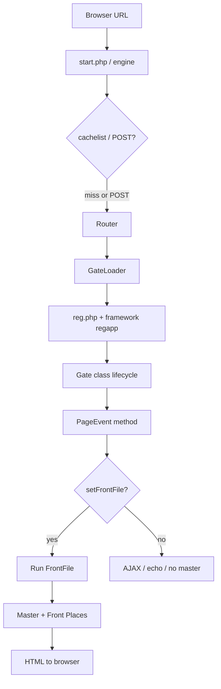

# Browser Request and SartajPhp Response Work-Flow

Teach an AI how a browser URL becomes Gate + PageEvent output (FrontFile + Master HTML). Scope: the request/response pipeline only. Gates, masters, fronts, components, and AJAX depth are skills 02–06.

## When to use

- Creating a first Web App page in SartajPhp
- Explaining why `gate.html` vs `gate-event-param.html` hit different methods
- Debugging “page loaded but empty” (no `setFrontFile`) or wrong gate registration

## Mental model

SartajPhp is **Gate-Driven Event Architecture**, not MVC. The filename in the URL maps to:

1. **Gate** (request-word) → registered `*.gate.php` class  
2. **PageEvent** → method on that Gate  
3. **Optional `$evtp`** → event parameter  



### URL → PageEvent

| Browser URL | Method | Gate method |
|-------------|--------|-------------|
| `ex01flow.html` | GET | `page_new()` |
| `ex01flow.html` | POST | `page_submit()` (DB CRUD helpers may call plain `insert()` / `update()` from here — see skill 02) |
| `ex01flow-hello-world.html` | GET/POST | `page_event_hello($evtp = "world")` |
| Domain only / default | GET | Gate `index` (project `reg.php` or shared `vendor/.../Slib/apps/Index.gate.php`) |

Pattern: `gate-event-param.html` → first segment = gate name; next = event; remainder = `$evtp`.

Landing events are `page_new` / `page_submit`. Custom events use the `page_event_*` prefix.

## Develop

### 1. Create Gate + FrontFile

Minimal shape (also in `apps/examples/`):

```php
// apps/examples/Ex01flow.gate.php
use Sphp\Gates\BasicGate;
use Sphp\Tools\FrontFile;

class Ex01flow extends BasicGate
{
    private $frtMain = null;

    public function onstart()
    {
        global $masterf;
        $this->frtMain = new FrontFile('main'); // setup only
        $this->setMasterFile($masterf);
    }

    public function page_new()
    {
        $this->setFrontFile($this->frtMain); // bind FrontFile here
    }

    public function page_event_hello($evtp)
    {
        $this->setFrontFile($this->frtMain);
        $this->debug->println('evtp=' . $evtp);
    }
}
```

FrontFile path rule (relative to Gate file directory):

`fronts/` + `strtolower(ClassName)` + `_` + name + `.front`  
→ `apps/examples/fronts/ex01flow_main.front`

Front files: HTML + expression tags `##{ ... }#` + components. **No** PHP tags, and usually **no** `<html>` / `<body>` (Master supplies layout).

### 2. Register the Gate

In project `reg.php`:

```php
registerGate("ex01flow", __DIR__ . "/apps/examples/Ex01flow.gate.php");
```

Master path typically comes from `comp.php` (`$masterf`).

### 3. Build links with helpers

In a FrontFile:

```html
<a href="##{getGateUrl('ex01flow')}#">Landing</a>
<a href="##{getEventUrl('hello','world','ex01flow')}#">hello / world</a>
```

Definitions live under `vendor/sartajphp/sartajphp/res/Score/SphpDoc/Sphp/Tools/interfacefunctions.php`.

## Run

From project root:

```bat
sphpdesk\sphpserver\sphpserver-win.exe --proj .\ --port 8000 --host 127.0.0.1
```

Open:

- http://127.0.0.1:8000/ex01flow.html  
- http://127.0.0.1:8000/ex01flow-hello-world.html  

## Test / verify

| Check | Expect |
|-------|--------|
| Landing table | Gate=`ex01flow`, Event empty, Evtp empty, Front path ends with `ex01flow_main.front`, Master=`masters/default/master.mast.php` |
| Event URL table | Event=`hello`, Evtp=`world` |
| Full HTML page | `<html>` / layout from Master present when `setFrontFile` was called |
| Browser console | With `$debugMode` ≥ 1 in `comp.php`, framework debug JS; Gate `$this->debug->println` appears in console stream |
| Errors | Soft app errors via `setErr` / `getCheckErr`; coding failures → exception / `cache/Sphp_errorLog.txt` |

Verified locally (2026-10-20): both example URLs returned HTTP 200 with the mappings above.

## Pipeline details (for debugging)

1. Engine entry via `start.php` → `res/Score/{$libVersion}/global/start.php` (this demo: `SphpLatest`); stubs for agents: `SphpDoc/global/` + `SphpDoc/Sphp/Core/{Router,GateLoader}.php`. Cache registry `cachelist.php`; on miss or POST → Router → GateLoader.  
2. Gate resolved from framework `regapp.php` plus project `reg.php`.  
3. Gate lifecycle (`on*` handlers) then PageEvent for this URL (resolved by `Page` class; Gate handles only if method exists).  
4. `setFrontFile` → FrontFile run → Master include → Front Places → HTML. Without FrontFile, Master is skipped.  
5. `prerun.php` runs before Gate load (global includes, headers).  
6. Common APIs: `SphpBase` statics (`startEngine.php`); request data via `SphpBase::sphpRequest()` / `$this->client` in Gate.

## Pitfalls

- Inventing MVC controllers or routes — use Gate + PageEvent URL mapping.  
- Calling `setFrontFile` in `onstart` only for “always render” — prefer bind in `page_new` / the PageEvent that should render.  
- PHP inside `.front` files — use expression tags and components instead.  
- Expecting Master/layout on pure AJAX or bare `echo` responses.  
- Forgetting `registerGate` (or auto `apps/{name}.gate.php` discovery in this demo’s `reg.php`).

## Key paths

| Role | Path |
|------|------|
| Example Gate | `apps/examples/Ex01flow.gate.php` |
| Example Front | `apps/examples/fronts/ex01flow_main.front` |
| Registry | `reg.php` |
| Settings / master / debug | `comp.php` |
| Demo Master | `masters/default/master.mast.php` |
| URL rules (RAG) | `vendor/sartajphp/sartajphp/res/Score/rag/rules/chapter02.md` |
| Minimal sample | `vendor/sartajphp/sartajphp/res/Score/rag/samples/basicapp_minimal.md` |
| Flow sample | `vendor/sartajphp/sartajphp/res/Score/rag/samples/how_sartajphp_app_work.md` |
| Ebook | https://www.sartajphp.com/ebook2-fullbook.html |

## See also

- [02 — Project structure and APIs](02-project-structure-and-important-apis.md)  
- [03 — Gate class and PageEvents](03-how-to-write-gate-class-and-handle-events.md)  
- [04 — Front file](04-front-file-designing.md)  
- [05 — Master file](05-master-file-design.md)  
- [06 — Components](06-component-design-and-basic-components.md)  
- [07 — AJAX](07-sartajphp-ajax-library-use.md)  
