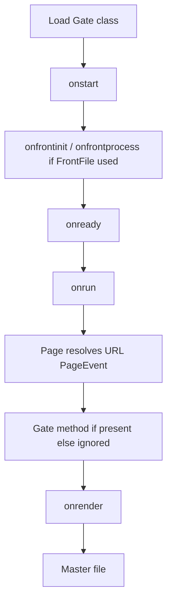

# How To Write Gate Class and Handle Events

Teach an AI how to author a `BasicGate` class: lifecycle hooks, URL → PageEvent mapping, and reading request / `$evtp` data. Builds on [01 — request/response](01-browser-request-and-sartajphp-response-workflow.md) and [02 — APIs](02-project-structure-and-important-apis.md).

## When to use

- Adding a new Gate (`*.gate.php`) and registering it
- Choosing `page_new` vs `page_submit` vs `page_event_*`
- Reading browser data (`$this->client`) or event parameter (`$evtp`)
- Understanding lifecycle order when debugging “when does my code run?”

## Mental model

A **Gate** is the entry class for one request-word. Two different event systems:

| Kind | Naming | Who triggers | Role |
|------|--------|--------------|------|
| **Lifecycle events** | Methods starting with `on` (`onstart`, `onrun`, …) | Gate lifecycle | Run every request (in order) for setup / render phases |
| **PageEvents** | `page_new`, `page_submit`, and custom `page_event_*` | `Page` class from the URL (`vendor/.../SphpDoc/Sphp/Kit/Page.php`) | One request intent; **not** lifecycle |

`Page` sets event name / `$evtp` / flags from the URL. The Gate **handles** a PageEvent only if it implements that method; if it does not, that PageEvent is **ignored**.



Gate types (overview): `BasicGate` (HTTP/AJAX web), `NativeGate` (WebSocket / SphpServer), `ConsoleGate` (CLI). This skill focuses on **BasicGate**.

Reference sources: installed `vendor/sartajphp/sartajphp/`, ebook site, and ebook/RAG tree at `D:\www\SartajPHPWeb\apps\ebook`.

## Develop

### 1. Gate class skeleton

```php
// apps/examples/Ex02events.gate.php
use Sphp\Gates\BasicGate;
use Sphp\Tools\FrontFile;

class Ex02events extends BasicGate
{
    private $frtMain = null;

    public function onstart()
    {
        global $masterf;
        $this->frtMain = new FrontFile('main'); // setup: create FrontFile, auth, defaults
        $this->setMasterFile($masterf);
    }

    public function page_new()
    {
        $this->setFrontFile($this->frtMain); // GET gate.html
    }

    public function page_submit()
    {
        $name = $this->client->request('txtname');
        // Soft errors: setErr / getCheckErr (not throw) for user/validation issues
        $this->setFrontFile($this->frtMain); // POST gate.html
    }

    public function page_event_ping($evtp)
    {
        // GET gate-ping-ok.html → $evtp === "ok"
        // Also: $this->getEventParameter(), $this->page->evtp
        $this->setFrontFile($this->frtMain);
    }
}
```

Register:

```php
registerGate("ex02events", __DIR__ . "/apps/examples/Ex02events.gate.php");
```

Front path: `apps/examples/fronts/ex02events_main.front`.

### 2. Lifecycle event handlers (prefix `on`)

Lifecycle handlers **start with `on`**. From `vendor/sartajphp/sartajphp/res/Score/SphpDoc/Sphp/Tools/Gate.php`:

| Order | Method | Role |
|-------|--------|------|
| 1 | `onstart()` | Gate start: FrontFile object, master, auth, table defaults |
| 2 | `onfrontinit($frontobj)` | After FrontFile parse (if FrontFile used) |
| 3 | `onfrontprocess($frontobj)` | After component create phase (if FrontFile used) |
| 4 | `onready()` | FrontFile ready; Gate about to run |
| 5 | `onrun()` | Immediately **before** PageEvent dispatch (demo `Index` maps SEO URLs here) |
| 10 | `onrender()` | After FrontFile run, before Master; can adjust master / places |

These are **not** PageEvents. **Do not invent** methods like `index()`, `init()`, `handleRequest()` (`rag/anti-patterns/invented_lifecycle.md`).

### 3. PageEvent mapping (URL → Gate method)

PageEvents are resolved by `vendor/sartajphp/sartajphp/res/Score/SphpDoc/Sphp/Kit/Page.php` from the browser URL, then invoked on the Gate **if** the handler exists.

| URL / method | Handler on Gate (if implemented) |
|--------------|----------------------------------|
| GET `gate.html` | `page_new()` |
| POST `gate.html` | `page_submit()` |
| `gate-ping-ok.html` | `page_event_ping($evtp = "ok")` |

Custom PageEvents use the `page_event_*` prefix. `$evtp` is everything after the event name in the URL. Prefer the method argument; equivalents: `$this->getEventParameter()`, `$this->page->getEventParameter()`, `$this->page->evtp`.

Database list/edit apps often add more `page_event_*` handlers and plain methods (`insert()`, `update()`) via `AutoGate` / `AutoGatePermis` — see section 5.

### 4. Useful Gate members

| Member | Use |
|--------|-----|
| `$this->page` | Event, master path, forwards |
| `$this->client` | Browser request/post/session data |
| `$this->jsServer` | AJAX JSON replies (skill 06) |
| `$this->debug` | `$this->debug->println(...)` |
| `$this->myPath` | Gate directory filesystem path |
| `setFrontFile` / `setMasterFile` | Bind UI for this request |
| `getAuthenticate("GUEST,ADMIN")` | Role gate; failure → `getWelcome()` in `comp.php` |

Form POST to a **custom** event (not landing `page_submit`) is also valid — see vendor sample `calculator_http_post.md` (`action="##{getEventUrl('calc')}#"` → `page_event_calc`).

### 5. Database CRUD helpers (knowledge — fixed two-FrontFile AJAX style)

For list + edit apps, extend helpers under `vendor/sartajphp/sartajphp/res/Slib/apps/helper/` (fixed AJAX two-FrontFile style).

| Class | Role |
|-------|------|
| `AutoGate.php` | CRUD over two FrontFiles + AJAX (`jsServer`) |
| `AutoGatePermis.php` | Same pattern + permission checks (`hasPermission`) |
| `GenAppFromDb.php` | **Code generator hints**: emit Gate + edit/list FrontFile markup from a DB table |

**Fixed style (both AutoGate variants):**

1. `$genFormFront` — edit/insert form (default form id `form2`)  
2. `$showallFront` — list via Grid/Pagination component id `showall`  

Typical flow:

- `page_new` → render `$showallFront` (full page + Master)  
- `page_submit` → if form `isUpdateRequest()` call plain method `update()`, else `insert()` (not PageEvents)  
- AJAX `page_event_*`: `rowclick`, `addform` / `showall_newa`, `showall_show`, `usersrch`, `delete`, `loadform`, `print`, …  
- DB work uses `$this->page->insertData` / `updateData` / `viewData` / `deleteRec` on the bound form component  

`GenAppFromDb::getGate($tablename, $gate)` shows the expected child shape: extend `AutoGate`, set table + both FrontFiles in `onstart`, then `parent::onstart()`.

Demo project mirrors this with `apps/permis/PermisGate.php` and gates like `MebProfile.gate.php` (`FrontFile("edit")` + `FrontFile("list")`).

Do **not** use AutoGate for every Gate — only DB-driven list/edit UIs that match this AJAX dialog style. Simple pages stay on `BasicGate` (this skill’s Ex02 example).

## Run

```bat
sphpdesk\sphpserver\sphpserver-win.exe --proj .\ --port 8000 --host 127.0.0.1
```

- http://127.0.0.1:8000/ex02events.html  
- http://127.0.0.1:8000/ex02events-ping-ok.html  
- Submit the form on the landing page (POST → `page_submit`)

## Test / verify

Verified 2026-10-20:

| Check | Expect |
|-------|--------|
| GET landing | Trace ends with `page_new`; Event empty |
| GET `…-ping-ok.html` | Event=`ping`, param=`ok`; note shows matching `$evtp` / helpers |
| POST `txtname=Ada` | Trace ends with `page_submit`; note `txtname=Ada` |
| Lifecycle prefix (FrontFile created in `onstart`) | `onstart → onfrontinit → onfrontprocess → onready → onrun → …` |
| `onrender` in FrontFile HTML | **Not** visible in Front expressions (runs after FrontFile evaluation) |

## Pitfalls

- Inventing lifecycle or controller-style methods (lifecycle handlers use the `on` prefix only).  
- Treating `page_event_*` as lifecycle events — they are PageEvents from `Page.php` / URL; Gate only handles them if methods exist.  
- Putting `page_event_*` as fake HTML attributes (`page_event_misuse.md`).  
- Expecting several PageEvents in one request — only one fires.  
- Confusing `page_submit` (landing POST) with POST to `getEventUrl('…')` (custom `page_event_*`).  
- Reading `$parentGate` state in FrontFile that is only set in `onrender`.  

## Key paths

| Role | Path |
|------|------|
| Example Gate / Front | `apps/examples/Ex02events.gate.php`, `apps/examples/fronts/ex02events_main.front` |
| Gate API / lifecycle | `vendor/sartajphp/sartajphp/res/Score/SphpDoc/Sphp/Tools/Gate.php` |
| PageEvent trigger | `vendor/sartajphp/sartajphp/res/Score/SphpDoc/Sphp/Kit/Page.php` |
| CRUD helpers | `vendor/sartajphp/sartajphp/res/Slib/apps/helper/AutoGate.php`, `AutoGatePermis.php` |
| Generate from table | `vendor/sartajphp/sartajphp/res/Slib/apps/helper/GenAppFromDb.php` |
| Demo permis CRUD | `apps/permis/PermisGate.php`, `apps/permis/MebProfile.gate.php` |
| Ebook / RAG sources | https://www.sartajphp.com/ebook2-fullbook.html , `D:\www\SartajPHPWeb\apps\ebook` |
| Demo gates | `apps/Index.gate.php`, `apps/IndexBack.gate.php` |

## See also

- [01 — Browser request / response](01-browser-request-and-sartajphp-response-workflow.md)  
- [02 — Project structure and APIs](02-project-structure-and-important-apis.md)  
- [04 — Front file](04-front-file-designing.md)  
- [05 — Master file](05-master-file-design.md)  
- [07 — AJAX](07-sartajphp-ajax-library-use.md)  
- [09 — Permissions and authentication](09-permissions-and-authentication.md)  
