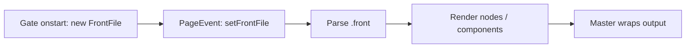

# Front File designing

Teach an AI how to write SartajPhp **FrontFiles** (`.front`): expression tags, Components (`runat="server"`), holders (`runas="holder"`), and script helpers (`runas="jsfunctioncode"`). Builds on [01](01-browser-request-and-sartajphp-response-workflow.md)–[03](03-how-to-write-gate-class-and-handle-events.md). Deep fusion attributes / custom Components → [06](06-component-design-and-basic-components.md). Master layout → [05](05-master-file-design.md).

## When to use

- Creating UI templates next to a Gate (`fronts/*.front`)
- Binding Gate data into HTML without PHP tags
- Choosing expression vs Component vs holder
- Injecting JS into framework `ready()` / asset `filelink`

## Mental model

A FrontFile is **parsed by SartajPhp**, not executed as PHP. It defines UI; the Gate binds it with `setFrontFile` after creating `new FrontFile('name')` (usually in `onstart`).



Path rule (relative to Gate file directory):

`fronts/` + `strtolower(ClassName)` + `_` + name + `.front`  
→ e.g. `apps/examples/fronts/ex04front_main.front`

## Develop

### 1. Rules (hard)

| Do | Do not |
|----|--------|
| Extension `.front` | `.php`, `.html`, `.tpl` as FrontFile |
| Expression tags `##{ ... }#` | `<?php ... ?>` inside FrontFile |
| HTML fragments for page body | Full `<html>` / `<body>` (Master owns those) |
| `runat="server"` + unique `id` for Components | Components without `id` |

### 2. Expression tags

Evaluate limited PHP expressions and print output:

```html
<p>##{$parentGate->bannerText}#</p>
<p>##{$frontobj->getFilePath()}#</p>
<a href="##{getGateUrl('ex04front')}#">Home</a>
```

Common objects in expressions: `$parentGate`, `$frontobj`, helpers like `getGateUrl` / `getEventUrl`, settings/router when available.

### 3. Components — `runat="server"`

Creates a server Component object (id = PHP property on the FrontFile):

```html
<span id="spnMsg" runat="server">default</span>
<input id="txtName" runat="server" type="text" />
```

In Gate:

```php
$this->frtMain = new FrontFile('main'); // onstart
// page_new:
$this->frtMain->spnMsg->setInnerHTML('set from Gate');
$this->setFrontFile($this->frtMain);
```

Form controls should be Components when server validation/state is needed (skill 06). Prefer id prefixes (`txt`, `btn`, …) from RAG chapter04.

### 4. Holders — `runas="holder"`

Placeholder **without** creating a Component. Verified patterns in this project:

```html
<!-- Copy from another Component property -->
<span id="spnSrc" runat="server">text from spnSrc</span>
<div runas="holder" sphp-comp="spnSrc" sphp-comp-prop="innerHTML"></div>

<!-- Bare holder → Gate must implement onholder($element) -->
<div runas="holder"></div>
```

```php
public function onholder($element)
{
    $element->setInnerHTML('filled by Gate onholder()');
}
```

**Pitfall:** bare `runas="holder"` without `onholder` → exception (`Call to undefined method …::onholder()`).

Ebook/RAG also document `sphp-app-prop` / `sphp-app-fun` and FrontFile `addProp`. On the installed package used for Ex04, those attrs fell through to `onholder` — prefer **verified** `sphp-comp` / expressions / `onholder`, or re-test before teaching `sphp-app-*`.

Grids often use: `<td runas="holder" sphp-comp="showall" dfield="fieldname"></td>`.

### 5. `runas` on scripts / links (overview)

| `runas` | Role |
|---------|------|
| `jsfunctioncode` + `function="ready"` | Inject body into framework `ready()` |
| `jsfunction` | Define a named JS function |
| `jsfunctionbnd` / `jsfunctionbnds` | Bind JS event (± AJAX to server) |
| `filelink` | Relocate `<link>` / `<script>` assets |
| `holder` | Dynamic placeholder (above) |

Optional `renderonce="true"`: still runs on server; suppresses re-sending that output on later AJAX responses.

### 6. Code blocks — `runcb="true"`

Reusable layout transforms via `SphpCodeBlock::addCodeBlock` and `sphp-cb-*` (no Component). Theme via `masters/sphpcodeblock.php` without editing FrontFiles → full skill [08 — Code Blocks](08-code-blocks-and-frontfile-theming.md).

### Minimal Gate + Front

See `apps/examples/Ex04front.gate.php` and `ex04front_main.front`.

## Run

```bat
sphpdesk\sphpserver\sphpserver-win.exe --proj .\ --port 8000 --host 127.0.0.1
```

Open http://127.0.0.1:8000/ex04front.html — check page text and browser console for the `jsfunctioncode` log.

## Test / verify

Verified 2026-10-20:

| Check | Expect |
|-------|--------|
| Expression Gate property | `Banner from Gate property` |
| Component `setInnerHTML` | `setInnerHTML from Gate page_new` |
| Holder + `sphp-comp-prop` | `text from spnSrc` inside `#holdComp` |
| Bare holder | `filled by Gate onholder()` |
| JS ready inject | Response contains `ex04front: jsfunctioncode injected` |
| No PHP tags | Front source has none |

## Pitfalls

- PHP inside `.front` (`php_in_frontfile.md`).  
- Wrong extension (`wrong_front_extension.md`).  
- Bare `runas="holder"` without `onholder`.  
- Creating FrontFile only in `page_new` every time without need — prefer `onstart` create + PageEvent `setFrontFile`.  
- Assuming Master runs when FrontFile was never set (skill 01).

## Key paths

| Role | Path |
|------|------|
| Example | `apps/examples/Ex04front.gate.php`, `apps/examples/fronts/ex04front_main.front` |
| FrontFile API | `vendor/sartajphp/sartajphp/res/Score/SphpDoc/Sphp/Tools/FrontFile.php` |
| Rules | `vendor/.../rag/rules/chapter03.md`, `chapter04.md` |
| Ebook | `D:\www\SartajPHPWeb\apps\ebook\book2\chapter5.md`, `chapter9.md` |
| Anti-patterns | `vendor/.../rag/anti-patterns/php_in_frontfile.md` |

## See also

- [03 — Gate / PageEvents](03-how-to-write-gate-class-and-handle-events.md)  
- [05 — Master file](05-master-file-design.md)  
- [06 — Components](06-component-design-and-basic-components.md)  
- [07 — AJAX](07-sartajphp-ajax-library-use.md)  
