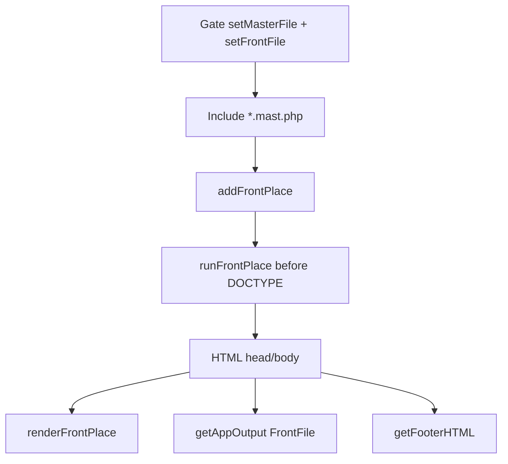

# Master File Design

Teach an AI how to build SartajPhp **Master files** (`.mast.php`): HTML layout, Front Places, and injecting Gate/FrontFile output with `SphpBase::getAppOutput()`. Builds on [01](01-browser-request-and-sartajphp-response-workflow.md)–[04](04-front-file-designing.md).

## When to use

- Creating or changing the site-wide layout (header, nav, footer)
- Adding a menu/sidebar as a **Front Place**
- Switching Masters per Gate (`setMasterFile`) vs project default (`$masterf` in `comp.php`)
- Debugging “FrontFile runs but no chrome” / wrong layout

## Mental model

The **Master** is a **procedural PHP script** (not a Gate class). After the Gate PageEvent sets a FrontFile, the engine includes the Master. The Master:

1. Registers/runs Front Places  
2. Prints `<html>` layout  
3. Calls `SphpBase::getAppOutput()` where the FrontFile HTML belongs  
4. Emits framework footer assets  



**No FrontFile → Master is not used** (AJAX / bare echo path — skill 01).

## Develop

### 1. Choose Master from Gate

Project default in `comp.php`:

```php
$masterf = "masters/default/master.mast.php";
```

In Gate `onstart`:

```php
global $masterf;
$this->setMasterFile($masterf);           // shared default
// or a custom layout:
$this->setMasterFile("masters/examples/ex05.mast.php");
```

Path is relative to the project root (as used in this demo).

### 2. Master skeleton

```php
<?php
addFrontPlace("ex05bar", __DIR__ . "/ex05bar.place.front", "header");
runFrontPlace("ex05bar", "header");
?>
<!DOCTYPE html>
<html>
<head>
    <?php
        SphpBase::SphpJsM()::addBootStrap();
        echo SphpBase::sphpApi()->getHeaderHTML();
    ?>
</head>
<body>
    <?php renderFrontPlace("ex05bar", "header"); ?>
    <main>
        <?php SphpBase::getAppOutput(); ?>
    </main>
    <?php
        echo SphpBase::sphpApi()->getFooterHTML();
        echo SphpBase::sphpApi()->traceError(true) . SphpBase::sphpApi()->traceErrorInner(true);
    ?>
</body>
</html>
```

| Call | When / where |
|------|----------------|
| `addFrontPlace($name, $path, $section)` | Top of Master — register place file |
| `runFrontPlace($name, $section)` | After add, **before** `<!DOCTYPE>` — execute place logic |
| `renderFrontPlace($name, $section)` | Inside HTML — print place output |
| `SphpBase::getAppOutput()` | Inside HTML — print Gate FrontFile result |
| `getHeaderHTML()` / `getFooterHTML()` | Head / end of body — framework CSS/JS |

### 3. Front Places

Reusable chrome pieces (menu, sidebar, footer). Extensions in practice: `*.place.php` (class, e.g. demo `menu.place.php` extending BootstrapMenu) or `*.place.front` (FrontFile-style markup — Ex05).

Demo default menu: `masters/default/menu.place.php` (class name `menu` matches place name).

Ex05 place: `masters/examples/ex05bar.place.front` — HTML fragment rendered into the header section.

### 4. Minimal Gate + Front for a custom Master

See `apps/examples/Ex05master.gate.php` + `ex05master_main.front` + `masters/examples/ex05.mast.php`.

## Run

```bat
sphpdesk\sphpserver\sphpserver-win.exe --proj .\ --port 8000 --host 127.0.0.1
```

- http://127.0.0.1:8000/ex05master.html — custom master + place  
- http://127.0.0.1:8000/index.html — default `$masterf` master (for contrast)

## Test / verify

Verified 2026-10-20:

| Check | Expect |
|-------|--------|
| Custom wrap | `#ex05-master-wrap`, meta `ex05-master` |
| Front Place | Text `Ex05 Front Place` / path `ex05bar.place.front` |
| App output | Front heading inside `<main>` |
| Master footer | `Ex05 master footer` after content |
| `##{$parentGate->page->masterfilepath}#` | `masters/examples/ex05.mast.php` |
| `index.html` | Does not contain `ex05-master-wrap` |

## Pitfalls

- Forgetting `getAppOutput()` — layout with empty content area.  
- Calling `renderFrontPlace` without prior `add` + `run`.  
- Putting `runFrontPlace` after HTML has started (run before DOCTYPE).  
- Expecting Master on requests with no `setFrontFile`.  
- Confusing Master (layout PHP) with FrontFile (page UI `.front`).

## Key paths

| Role | Path |
|------|------|
| Example Gate / Front | `apps/examples/Ex05master.gate.php`, `fronts/ex05master_main.front` |
| Example Master / Place | `masters/examples/ex05.mast.php`, `ex05bar.place.front` |
| Default Master / menu | `masters/default/master.mast.php`, `menu.place.php` |
| Default setting | `comp.php` → `$masterf` |
| Sample guide | `vendor/.../rag/samples/create_use_master_file.md` |
| Ebook | `D:\www\SartajPHPWeb\apps\ebook\book2\chapter8.md` |

## See also

- [01 — Request / response](01-browser-request-and-sartajphp-response-workflow.md)  
- [04 — Front file](04-front-file-designing.md)  
- [06 — Components](06-component-design-and-basic-components.md)  
