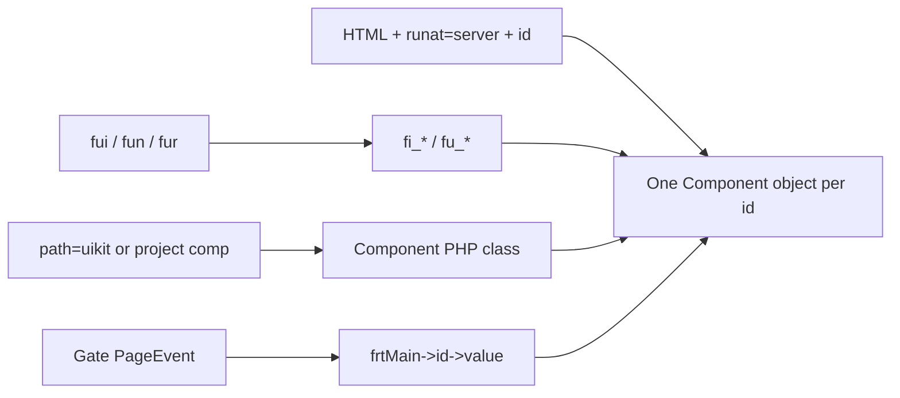

# Component Design and Basic Components

Teach an AI how SartajPhp **Components** work: `runat="server"`, fusion attributes, built-in form controls, **same-id reuse**, **UI kit path keywords**, **wrapping JS/jQuery UI into project Components** under `comp/`, and **ComponentGroup + CompGate** for complex UI owned by one Component. Builds on [04 — Front files](04-front-file-designing.md). AJAX → [07](07-sartajphp-ajax-library-use.md).

## When to use

- Building forms with server validation and state
- Reusing one Component object across many tags (labels, loop cells)
- Loading UI-kit Components via `path="uikit/..."`
- Converting a jQuery/plugin or native JS widget into a reusable Component
- Reading `$front->txtName->value` after submit
- Shipping a complex editor/widget as one FrontFile tag (`ComponentGroup` + CompGate + child FrontFile)

## Mental model



- **`runat="server"`** + **`id`** → Component object on the FrontFile.  
- **Same `id` many times** → still **one** PHP object; markup can render **many** times.  
- **Only Fusion methods** (`fi_*` / `fu_*`) are callable from the Front via Fusion attributes.  
- **`runas` / `runcb` do not create Components** (skill 04).

## Develop

### 1. Turn a tag into a Component

```html
<input id="txtName" runat="server" type="text" />
<form id="form1" runat="server" method="post" action="##{getEventUrl('save','','ex06comp')}#">
```

Gate:

```php
$this->frtMain->txtName->value;
$this->frtMain->spnResult->setInnerHTML('...');
$this->setFrontFile($this->frtMain);
```

### 2. Fusion methods and Front attributes (SartajPhp rules)

Components expose **two** Fusion-method prefixes. The Component author chooses which prefix a method gets:

| PHP prefix | Meant for | Example |
|------------|-----------|---------|
| **`fi_*`** | **Initialize** time | Validation (`setRequired`, `setMinLen`), bind form, FileUploader MIME/save path — run when the Component is created so POST data is checked immediately and soft errors can stop further work |
| **`fu_*`** | **Render** time (and anytime later from Gate) | Change label text, page size, visibility — safe to call again when the same Component object renders more than once |

Only these Fusion methods can be invoked from a FrontFile, and only through Fusion attributes.

**Naming:** Front attributes stay **kebab-case** (`fui-setForm`, `fun-setPerPageRows`, `fun-setrender`). PHP methods use **`fi_` / `fu_` + CamelCase tail** (`fi_setForm`, `fu_setPerPageRows`, `fu_setRender`). Prefer example Gates over stub comments that still show all-lowercase tails.

#### FrontFile: three Fusion-attribute prefixes

| Attribute | May call | When | How often |
|-----------|----------|------|-----------|
| **`fui-*`** | **`fi_*` only** | Initialize (while `new FrontFile` builds DOM, parent→child) | **Once** in the Component’s life |
| **`fur-*`** | **`fu_*` only** | **Each render** | **Every** render — same object can emit many HTML nodes with different `fur-*` values (e.g. one Label Component, several labels with different text, other attrs shared) |
| **`fun-*`** | **`fi_*` at init** and/or **`fu_*` at render** | Init and/or first render path | **One** call for the whole life of the Component (not every re-render like `fur-*`) |

```html
<input id="txtName" runat="server" type="text"
  fui-setForm="form1" fui-setRequired="" fui-setMinLen="3"
  fun-setMsgName="Name" />

<!-- Same Label id, different text each render: -->
<label id="lbl1" runat="server" path="uikit/html/HLabel.php" fur-setLabel="Name,|txtName">
<label id="lbl1" runat="server" path="uikit/html/HLabel.php" fur-setLabel="Email,|eml1">
```

Empty attribute value = call with no args. Soft validation uses `setErr` / `getCheckErr`.

#### Agent rules (ownership and Gate)

1. **Prefer Front fusion** (`fui-*` / `fun-*` / `fur-*`) so the Component keeps its lifecycle (`oncreate`, validation, `saveFile`, …).
2. **`fui-*` / Gate `fi_*` — init only, once.** Do **not** call `fi_*` in Gate **after** `new FrontFile(...)` unless you knowingly redo init work (FileUploader: late `fi_setFileSavePath` misses `oncreate` → `saveFile`).
3. **`fu_*`:** callable anytime after the Component exists (Front `fur-*`/`fun-*` or Gate `$comp->fu_*()`), but **one owner**. Prefer Front fusion. Use Gate `fu_*` when you must **change flow** or **change values in different Page-Events**. If you decide to call any `fu_*` in the Gate, **do not** also set that option on the Front (`fun-*` / `fur-*`) — **always set it in the Gate class** so Page-Events can override cleanly. If both Front and Gate set the same thing, **Front usually wins**.
4. Shared literals → Gate public property + Front `##{$parentGate->…}#` (no duplicated strings).
5. Extra Gate code beyond fusion only when you must **change** Component behavior (e.g. `blndontsave` + manual save).

Live AJAX/WS: `fun-submitAJAX` → `fu_submitAjax`, `fun-submitWS` → `fu_submitWs`. Detail → [07](07-sartajphp-ajax-library-use.md). Upload → [17](17-builtin-form-and-data-components.md).

### 3. Same Component `id` — one object, many renders

If several Component tags share the **same `id`**, FrontFile creates **one** PHP object and can **render it multiple times**. Use **`fur-*`** when each render needs a different `fu_*` value (Ex06 `lbl1` three times).

**Loops:** inside Pagination / ForEach / Grid, a child tag is written **once** but rendered **once per row**. Still one object; holders often use `sphp-comp="showall" dfield="…"`.

Do not assume “one id = one HTML node only.” Assume “one id = one server object.”

### 4. Path keywords and UI kit (`uikit`)

Reserved path keywords work **only** in FrontFile attribute values (not as PHP variables in Gate):

| Keyword | Resolves to |
|---------|-------------|
| `uikit` | Active UI kit root (`uiKitPath`, usually `…/components` + `$uiKitLocation`) |
| `components` | `res/components` |
| `slibPath` / `myPath` / `resourcePath` / … | Matching `SphpBase::sphpSettings()` paths |

Default in `comp.php` / global settings:

```php
$uiKitLocation = "/uikitdef/bootstrap";
```

Then `path="uikit/html/HLabel.php"` loads from that kit. Override `$uiKitLocation` in project `comp.php` to switch kits.

### 5. Built-in HTML → class map

| Tag / type | Typical class |
|------------|----------------|
| `input` text/email/… | TextField |
| `input` **file** | **FileUploader** (`Sphp\Comp\Form\FileUploader`) |
| `form` | HTMLForm |
| `select` / `textarea` | Select / TextArea |
| `alert` | DisplayError |
| Other | `Tag` fallback |

Prefer id prefixes: `txt`, `eml`, `pwd`, `num`, `btn`, `file`, `slt`, …

### 6. Designing a custom Component (jQuery plugin → Component)

Goal: take UI found online (jQuery plugin, native JS widget, etc.) and wrap it so FrontFiles reuse one tag.

**Steps:**

1. Create PHP class under project **`comp/`** (subfolders by kind), e.g. `comp/form/PhoneField.php`.  
2. Extend `Sphp\Tools\Component` or a form base like `\Sphp\Comp\Form\TextField`.  
3. Expose Fusion methods: **`fi_*`** for init/validation, **`fu_*`** for render-time setters (Front calls them only via `fui-*` / `fur-*` / `fun-*`).  
4. In **`onjsrender`**: load plugin CSS/JS (`addFileLink` / `addFooterJSCode`) and initialize on `#{$this->name}`.  
5. In **`onrender` / `onprerender`**: adjust HTML attributes/layout if needed.  
6. In FrontFile: `runat="server"` + `id` + `path="…"`.

**Ex06 custom phone field** (native browser JS formatter — same wrapping pattern as a jQuery plugin):

- Class: [`comp/form/PhoneField.php`](../../comp/form/PhoneField.php)  
- Load from FrontFile (relative to FrontFile dir via `myPath`):

```html
<input id="txtPhone" runat="server" type="text"
  path="myPath/../../../comp/form/PhoneField.php"
  fui-setForm="form1" fun-setMsgName="Phone"
  fui-setRequired="" fui-setPhoneMinDigits="10" />
```

Keep project Components under **`comp/`** so they are portable across Gates.

### 7. Bind Component lifecycle to Gate handlers

FrontFile attributes opt a Component into Gate hooks:

| Attribute | Typical use |
|-----------|-------------|
| `on-init="true"` | Configure Component early (defaults, flags) |
| `on-create="true"` | After Component object is created |
| `on-startrender="true"` | Just before Component render |
| `on-endrender="true"` | After Component render |

**Naming:** `comp_{componentId}_on_{event}` on the Gate class — id matches the tag `id` (e.g. `txtPhone` → `comp_txtPhone_on_startrender`).

```html
<input id="txtPhone" runat="server"
  path="myPath/../../../comp/form/PhoneField.php"
  on-init="true"
  on-startrender="true"
  ... />
```

```php
public function comp_txtPhone_on_init($arglst)
{
    // $arglst["obj"] = Component instance
    // $arglst["evt"] = event name (e.g. "on-init")
    $comp = $arglst['obj'];
    $comp->setAttribute('data-ex06-init', '1');
}

public function comp_txtPhone_on_startrender($arglst)
{
    $comp = $arglst['obj'];
    $comp->setAttribute('data-ex06-hook', $arglst['evt']); // "on-startrender"
}
```

Use this when fusion attributes are not enough and the Gate must configure or react around render. (Ebook may also expose `element` / other keys in `$arglst`; always use `$arglst["obj"]` for the Component.)

### 8. Gate save handler (Ex06)

```php
public function page_event_save($evtp)
{
    if (!getCheckErr()) {
        $phone = $this->frtMain->txtPhone->value;
        $this->frtMain->spnResult->setInnerHTML('OK — ... Phone=' . $phone);
    } else {
        $this->frtMain->spnResult->setInnerHTML('Validation failed (getCheckErr)');
    }
    $this->setFrontFile($this->frtMain);
}
```

Files: `apps/examples/Ex06comp.gate.php`, `fronts/ex06comp_main.front`.

### 9. ComponentGroup + CompGate (complex Component)

Use **`ComponentGroup`** when the Component owns a **full mini-UI** (HTML/JS/CSS/PHP) designed with a **child FrontFile**, not HTML built in PHP. Examples: Tiny Editor, page editor, calculator.

| Piece | Role |
|-------|------|
| `ComponentGroup` subclass | e.g. `comp/calculator/Calculator.php` — `registerEvent`, `raiseEvent`; **no** `ongateevent` / `onprerender` overrides (final on base) |
| `CompGate` `*.cgate.php` | Under `CompGates/`, class in namespace `Sphp\CompGates`, **same name** as ComponentGroup. **Not** listed in `reg.php` — run by ComponentGroup, not GateLoader |
| Child FrontFile | Prefer `FrontFileComp` + `*.child.front`; CompGate `setFrontFile` supplies starting UI (CompGate does **not** use `page_new` for that) |

**Parent FrontFile — one line:**

```html
<div id="cal1" runat="server" path="myPath/../../../comp/calculator/Calculator.php"></div>
```

**Name prefix:** `FrontFileComp` prefixes child Component ids with the ComponentGroup id. Child `num1` → **`cal1num1`** in parent FrontFile and browser JS (avoids id clashes). Access in CompGate via `$this->nameprefix . "num1"`. If you use raw `FrontParser` instead of `FrontFileComp`, you must handle naming yourself.

**Lifecycle order (important):**

- CompGate **`onstart`** runs **after** registered Gate `onstart` / `onready` / `onrun`.
- CompGate **PageEvents** run **before** registered Gate PageEvents (handled inside Component `ongateevent`).
- CompGate has **no** `page_new` / `page_submit` as entry UI — initial markup is the child FrontFile set in CompGate `onstart`.

**Custom events** (not FrontFile `on-init` hooks): Component `registerEvent` / `raiseEvent`; parent Gate binds with `setEventHandler($comp, "EventName")` → `comp_{id}_{EventName}($arglst)`.

Dedicated demo: gate **`ex06group`** — `apps/examples/Ex06group.gate.php` + `fronts/ex06group_main.front` + `comp/calculator/`.

## Run

```bat
sphpdesk\sphpserver\sphpserver-win.exe --proj .\ --port 8000 --host 127.0.0.1
```

- http://127.0.0.1:8000/ex06comp.html — form Components / PhoneField / lifecycle hooks  
- http://127.0.0.1:8000/ex06group.html — ComponentGroup calculator (AJAX add)

## Test / verify

Verified 2026-10-20 (ComponentGroup re-verified):

| Check | Expect |
|-------|--------|
| Landing `ex06comp` | Three HLabel `control-label`s; `txtPhone` present; phone JS injected |
| Hooks | `data-ex06-init="1"`, `data-ex06-hook="on-startrender"`; log `init:on-init;startrender:on-startrender;` |
| POST Ada + email + `(555) 123-4567` | `OK — Name=Ada; Email=…; Phone=(555) 123-4567` |
| POST phone `123` | `Validation failed` + digits message from `fi_setPhoneMinDigits` |
| Landing `ex06group` | `data-ex06group="SendFull"`; log `SendFull;`; ids `cal1num1` / `cal1form2` |
| POST `ex06group-calup.html` `12`+`34` | JSON `caldiv1` = `Result:- 46`; parent JS logs `result=46` |

## Pitfalls

- Form controls without `runat="server"`.  
- Inventing fusion names that are not `fi_*`/`fu_*` on the class.  
- Expecting multiple same `id` tags to create multiple PHP objects.  
- Hard-coding UI kit folders instead of `uikit` + `$uiKitLocation`.  
- Putting one-off JS only in a FrontFile when the widget should be a reusable `comp/` Component.  
- Wrong Gate method name for hooks — must be `comp_{id}_on_{event}` and FrontFile must set `on-…="true"`.  
- Registering CompGate in `reg.php` — not needed; ComponentGroup loads `CompGates/*.cgate.php`.  
- Forgetting name prefix when reading child Components from CompGate / parent.  
- Using `FrontParser` in CompGate without understanding missing auto-prefix (prefer `FrontFileComp`).  
- AJAX forms (`fun-setAJAX`) details — skill 07.

## Key paths

| Role | Path |
|------|------|
| Example Gate / Front | `apps/examples/Ex06comp.gate.php`, `fronts/ex06comp_main.front` |
| ComponentGroup demo | `apps/examples/Ex06group.gate.php`, `fronts/ex06group_main.front` |
| Calculator ComponentGroup | `comp/calculator/Calculator.php` |
| Calculator CompGate + child | `comp/calculator/CompGates/Calculator.cgate.php`, `CompGates/fronts/calculator.child.front` |
| Custom PhoneField | `comp/form/PhoneField.php` |
| UI kit (default) | `vendor/.../res/components/uikitdef/bootstrap/` |
| `$uiKitLocation` | `vendor/.../Score/global/global.php` (override in `comp.php`) |
| HLabel | `.../uikitdef/bootstrap/html/HLabel.php` |
| Same-id reference Front | `D:\www\sp.itkruze.com\apps\company\fronts\company_product_edit.front` |
| Component / ComponentGroup API | `vendor/.../SphpDoc/Sphp/Tools/Component.php` |
| CompGate API | `vendor/.../SphpDoc/Sphp/Gates/CompGate.php` |
| Path keywords | `vendor/.../rag/rules/chapter03.md` |

## See also

- [04 — Front file](04-front-file-designing.md)  
- [03 — Gate / PageEvents](03-how-to-write-gate-class-and-handle-events.md)  
- [07 — AJAX](07-sartajphp-ajax-library-use.md)  
- [09 — Permissions and authentication](09-permissions-and-authentication.md)  
