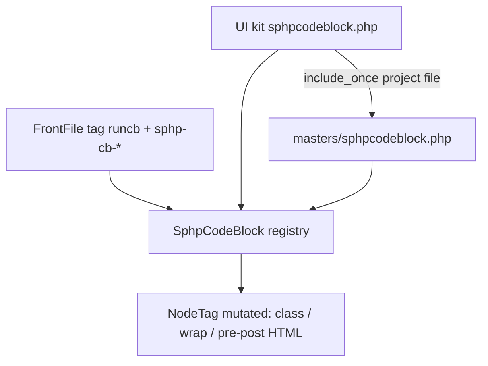

# Code Blocks and FrontFile theming

Teach an AI how SartajPhp **Code Blocks** restyle **non-Component** tags via `runcb="true"` / `sphp-cb-*`, and how to **theme a project** by adding or overriding blocks in `masters/sphpcodeblock.php` without changing FrontFiles. Complements [04 — Front files](04-front-file-designing.md). Behavior / state → [06 — Components](06-component-design-and-basic-components.md).

## When to use

- Reusable layout wrappers (card, border, shadow, callouts) without PHP Components
- Keeping FrontFiles semantic while centralizing Bootstrap/theme markup
- Swapping visual theme project-wide by editing one `sphpcodeblock.php`
- Combining several presentational transforms on one tag

## Mental model



- **Code Block** = registered callback (or para defaults) that mutates a **NodeTag**.
- **Does not** create a Component or Gate lifecycle hooks.
- **UI kit** supplies shared blocks; **project** file loads **after** and can replace names.

## Develop

### 1. Apply a block in a FrontFile

```html
<div runcb="true" sphp-cb-card="Card title">
  Body stays in the FrontFile.
</div>

<!-- Several blocks on one tag -->
<div runcb="true" sphp-cb-border="3" sphp-cb-color="primary">
  Border width + text color.
</div>
```

| Piece | Role |
|-------|------|
| `runcb="true"` | Enable Code Block processing on this tag |
| `sphp-cb-{name}` | Run registered block `{name}`; attribute value → `$args` |
| Shared definitions | `vendor/.../uikitdef/bootstrap/sphpcodeblock.php` |
| Project definitions | `masters/sphpcodeblock.php` (override or add) |

### 2. Register / override in `masters/sphpcodeblock.php`

```php
SphpCodeBlock::addCodeBlock(
    'ex08callout',
    function ($element, $args, $lstOther_CB) {
        $title = isset($args[0]) ? $args[0] : 'Note';
        $element->appendAttribute('class', ' alert alert-info');
        $element->appendInnerPreTag('<strong>' . $title . ':</strong> ');
    },
    array('documentation' => 'Project callout; arg0=title')
);

// Same name as UI kit → replaces shared "shadow"
SphpCodeBlock::addCodeBlock('shadow', function ($element, $args, $lstOther_CB) {
    // …theme-specific classes…
    $element->setAttribute('data-ex08-shadow', 'project');
}, array('documentation' => 'Project shadow override'));
```

Callback parameters:

| Param | Meaning |
|-------|---------|
| `$element` | `NodeTag` for this HTML tag |
| `$args` | Values from the attribute (see args note below) |
| `$lstOther_CB` | Other Code Blocks on the **same** tag (e.g. detect `color`) |

Optional `$para` keys: `class`, `pclass`, `pretag`, `posttag`, `innerpretag`, `innerposttag`, `documentation` (editors/helpers).

Useful NodeTag ops: `appendAttribute`, `setAttribute`, `appendPreTag` / `appendPostTag`, `appendInnerPreTag`, `setInnerPreTag` / `setInnerPostTag`, `iterateChildren`.

### 3. Args (verified)

Ebook/RAG examples use comma lists (`sphp-cb-border="4,white"` → `$args[0]`, `$args[1]`). **Verified on this project:** the full attribute string is `$args[0]` (commas are **not** auto-split). Prefer:

1. **One value per attribute**, compose blocks: `sphp-cb-border="3" sphp-cb-color="primary"`.
2. **Split in your callback** when you want `title,footer` in one attribute (see `ex08panel` in `masters/sphpcodeblock.php`).

### 4. Code Blocks vs Components

| Use | Prefer |
|-----|--------|
| Layout, wrappers, theme, CSS-class injection | Code Block |
| Form state, validation, events, AJAX handlers | Component (`runat="server"`) |

Rule of thumb: **Components control behavior; Code Blocks control structure.**

### 5. Example layout

| Role | Path |
|------|------|
| Gate / Front | `apps/examples/Ex08codeblock.gate.php`, `fronts/ex08codeblock_main.front` |
| Project blocks | `masters/sphpcodeblock.php` |
| Shared UI-kit blocks | `vendor/sartajphp/sartajphp/res/components/uikitdef/bootstrap/sphpcodeblock.php` |
| Optional CSS | `…/uikitdef/bootstrap/assets/sphpcodeblocks.css` |
| API stub | `vendor/.../SphpDoc/global/startEngine.php` (`SphpCodeBlock`) |

## Run

```bat
sphpdesk\sphpserver\sphpserver-win.exe --proj .\ --port 8000 --host 127.0.0.1
```

Open http://127.0.0.1:8000/ex08codeblock.html

## Test / verify

Verified 2026-10-25:

| Check | Expect |
|-------|--------|
| UI-kit `card` | Outer `.card`, header “Card title”, tag has `card-body` |
| `border` + `color` | Classes `border border-3 border-primary` and `text-primary` |
| Project `shadow` override | `shadow-lg` and `data-ex08-shadow="project"` |
| `ex08callout` | `alert alert-info`, `data-ex08="callout"`, bold Tip |
| `ex08panel="Panel title,Panel footer"` | Header + footer wrappers around body |

## Pitfalls

- Forgetting `runcb="true"` — `sphp-cb-*` alone does not run.
- Expecting Code Blocks to create Components or Gate `comp_*` hooks.
- Putting auth/state/validation in Code Blocks — use Components.
- Assuming ebook comma multi-args work without verifying; split in callback or use one value per attribute.
- Editing every FrontFile for a theme change — override in `masters/sphpcodeblock.php` instead.
- Leaving `masters/sphpcodeblock.php` missing — UI kit still `include_once`s it (keep a valid PHP file).

## See also

- [04 — Front file designing](04-front-file-designing.md)  
- [06 — Components](06-component-design-and-basic-components.md)  
- [05 — Master file](05-master-file-design.md)  
