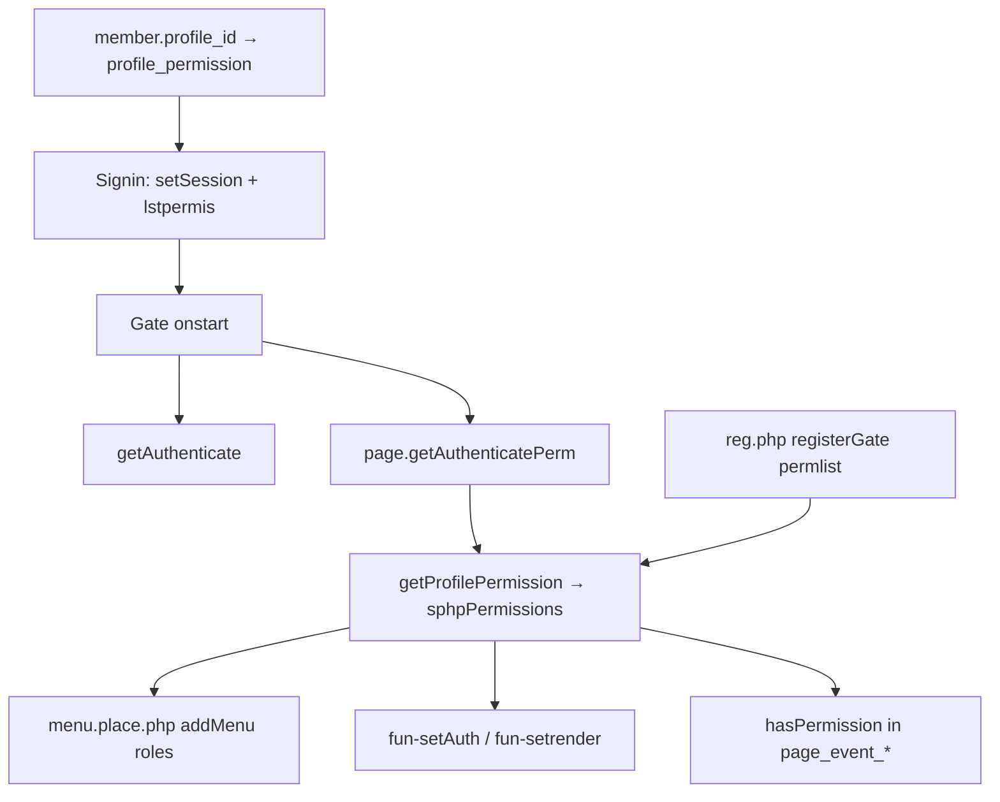

# Permissions and Authentication

Teach an AI how SartajPhp **login roles** (GUEST / MEMBER / ADMIN), **session**, **DB permission profiles**, **Gate `onstart` checks**, **SphpApi menus**, **FrontFile fusion render**, and **per-event permission bans** work together. Builds on [03 — Gates](03-how-to-write-gate-class-and-handle-events.md) and [06 — Components](06-component-design-and-basic-components.md).

## When to use

- Protecting member/admin Gates after Signin
- Showing/hiding menus by role or permission id (Front Place)
- Hiding FrontFile Components by auth or permission (server-side)
- Allowing a Gate but blocking one `page_event_*` handler
- Managing reusable permission **profiles** in the database and assigning them to users

## Mental model



Two layers:

1. **Authentication (role)** — `setSession('ADMIN'|'MEMBER', $uid)` → `getAuthenticateType()`.
2. **Authorization (permissions)** — loaded only via **`$this->page->getAuthenticatePerm()`** (calls private `getProfilePermission`). Do **not** call `SphpBase::sphpPermissions()->setPermissions()` yourself for normal login flows.

## Develop

### 1. Login Gate sets session

Production: `apps/permis/Signin.gate.php`.

| Path | Result |
|------|--------|
| `comp.php` `$adminUser` / `$adminPass` | `setSession('ADMIN', 0)` — **uid 0** = super admin |
| DB user | `setSession('MEMBER', id)` — **uid &gt; 0**; `lstpermis` = profile `permission_id` |
| Logout | `destSession()` |

Then `getWelcome()` in `comp.php` forwards by role.

### 2. `getAuthenticatePerm` loads and optionally enforces permissions

Call in **`onstart` after** `getAuthenticate`:

```php
public function onstart()
{
    global $mebmasterf;
    $this->getAuthenticate('ADMIN,MEMBER');
    $this->page->getAuthenticatePerm('view'); // require {gate}-view or getWelcome()+exit
    // …
}
```

| Call | Effect |
|------|--------|
| `getAuthenticatePerm()` | Load permission map only (`$perm === null` → everyone may continue) |
| `getAuthenticatePerm('view')` | Load map, then require `{currentGate}-view`; fail → `getWelcome()` + exit |
| `getAuthenticatePerm('view', 'otherGate')` | Check `otherGate-view` |

**What `getProfilePermission` builds** (inside Page):

| Session | Permission map |
|---------|----------------|
| `ADMIN` and `uid === 0` | **All** permissions from every `registerGate(..., $permlist)` → `{gate}-{perm}` |
| `MEMBER` and `uid > 0` | Keys from session `lstpermis` (comma list) |
| Always | Also adds current auth type as a permission (`ADMIN` / `MEMBER` / …) |

Then `SphpBase::sphpPermissions()->setPermissions($a1)`.

### 3. Register Gate permission catalog (`reg.php`)

```php
registerGate(
    'company_product',
    __DIR__ . '/apps/company/company_product.gate.php',
    '',
    'Company Product',
    array(
        array('view', 'Company Product View'),
        array('add', 'Add Company Product'),
        array('delete', 'Delete Company Product'),
    )
);
```

Ids: `company_product-view`, `company_product-add`, `company_product-delete`.  
Profile editor (`mebProfilePermission`) ticks these; values stored in `profile_permission.permission_id` and assigned via `member.profile_id`.

### 4. Menus — Front Place (project-wide)

Prefer **`*.place.php`** (PHP) or **`*.place.front`** under the master, e.g. `masters/default/menu.place.php` (wired from `master.mast.php`).

```php
SphpBase::sphpApi()->addMenu('Company', '', 'fa fa-home', 'root', false, 'ADMIN,MEMBER');
SphpBase::sphpApi()->addMenuLink(
    'Company Product',
    getGateUrl('company_product'),
    'fa fa-home',
    'Company',
    false,
    'company_product-view'
);
```

- Last `$roles` argument: auth types and/or permission ids (comma-separated).
- If the user **lacks** a matching permission/role, the menu/link is **not rendered** (automatic ban).
- From a Gate you may still **`banMenu` / `banMenuLink`** to force-hide.

Requires the permission system to be enabled for the request — call `getAuthenticatePerm()` in Gate `onstart` so the map exists before the master renders the menu place.

### 5. Disable Component render (Fusion / Gate)

```html
<div id="boxAdmin" runat="server" fun-setAuth="ADMIN">Admin only</div>
<div id="boxSecret" runat="server" fun-setrender="ex09permis-secret">Needs permission</div>
```

| Fusion | Method | Meaning |
|--------|--------|---------|
| `fun-setAuth` | `fu_setAuth` | Render if role matches |
| `fun-setUnAuth` | `fu_setUnAuth` | Hide if role matches |
| `fun-setrender` (Front kebab; often lowercase) | `fu_setRender` (PHP CamelCase) | Render if permission |
| `fun-unsetrender` | `fu_unsetRender` | Hide if permission |

```php
if ($this->page->hasPermission('delete')) {
    $btn->fu_setRender();
} else {
    $btn->fu_unsetRender();
}
```

### 6. Ban one event, not the whole Gate

```php
public function page_event_secret($evtp)
{
    if (!$this->page->hasPermission('secret')) {
        setErr('app', 'Permission Denied');
        $this->setFrontFile($this->frtMain);
        return;
    }
    // privileged work
}
```

Same pattern as `PermisGate` / `AutoGatePermis` around insert/update/delete.

### 7. Database model

| Table | Role |
|-------|------|
| `member` | Users; `profile_id`, credentials |
| `profile_permission` | Profiles; `permission_id` = comma list of `{gate}-{perm}` |

## Run

```bat
sphpdesk\sphpserver\sphpserver-win.exe --proj .\ --port 8000 --host 127.0.0.1
```

- Demo: http://127.0.0.1:8000/ex09permis.html  
- Signin: http://127.0.0.1:8000/signin.html  
- After login: `mebhome`, `mebProfile`, `mebProfilePermission`

## Test / verify

Verified 2026-10-25 via `ex09permis` (permissions via `getAuthenticatePerm` only):

| Check | Expect |
|-------|--------|
| GUEST | Role GUEST; view/secret/delete no; guest box only |
| Demo ADMIN (`setSession('ADMIN',0)`) | All registered perms; admin+secret UI; delete button |
| Demo MEMBER (`lstpermis` without delete) | secret yes; delete no; no admin box |
| `secret` event MEMBER / GUEST | OK / DENIED |
| Menu `ex09permis-secret` link | Present for MEMBER/ADMIN; absent for GUEST |
| `banMenuLink` | Forced hide of “Banned Link” |

## Pitfalls

- Manually calling `setPermissions` for login profiles — use **`getAuthenticatePerm()`** instead.
- Skipping `getAuthenticatePerm` — menus with permission roles and fusion `fun-setrender` will not see a permission map.
- Checking auth after other `onstart` work — call `getAuthenticate` first, then `getAuthenticatePerm`.
- CSS-only hide — use fusion / `fu_unsetRender`.
- Gate open ≠ every event allowed — still `hasPermission` in handlers.
- Empty `registerGate` `$permlist` — nothing for ADMIN auto-grant or profile UI to assign.
- Super-admin path needs **uid 0** (`setSession('ADMIN', 0)`); MEMBER needs **uid &gt; 0**.

## Key paths

| Role | Path |
|------|------|
| Demo | `apps/examples/Ex09permis.gate.php`, `fronts/ex09permis_main.front` |
| Signin / member apps | `apps/permis/` |
| Menu Front Place | `masters/default/menu.place.php` |
| Welcome / admin creds | `comp.php` |
| Page auth API | `vendor/.../SphpDoc/Sphp/Kit/Page.php` |
| SphpApi menu | `vendor/.../SphpDoc/Sphp/Core/SphpApi.php` |
| Component fusion | `vendor/.../SphpDoc/Sphp/Tools/Component.php` |

## See also

- [03 — Gate / PageEvents](03-how-to-write-gate-class-and-handle-events.md)  
- [05 — Master / Front Place](05-master-file-design.md)  
- [06 — Components / fusion](06-component-design-and-basic-components.md)  
