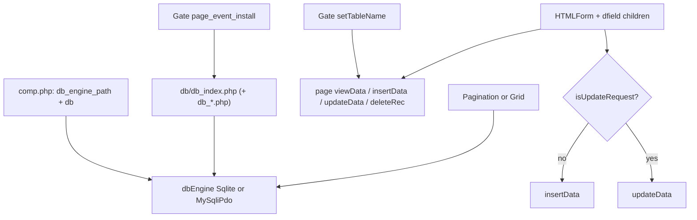

# Database communication in Gate

Teach an AI how SartajPhp Gates talk to the database: **`comp.php` engine settings**, **`Page` helpers**, **HTMLForm insert vs update**, **`db/db_index.php` schema install**, and **Pagination / Grid** lists. Builds on [03 — Gates](03-how-to-write-gate-class-and-handle-events.md) and [06 — Components](06-component-design-and-basic-components.md). Auth-gated CRUD → [09](09-permissions-and-authentication.md).

## When to use

- Binding FrontFile inputs to table columns (`dfield` / `dtable`)
- Inserting, updating, viewing, deleting via `$this->page->*Data`
- Installing project schema from a Gate event
- Listing rows with Pagination or Grid
- Switching SQLite (local demo) vs MySQL (production)

## Mental model



## Develop

### 1. Configure the engine (`comp.php`)

This doc project (SQLite file DB):

```php
$dbEnginePath = $libPath . '/Sphp/Lib/Sqlite.php,\\Sphp\\Lib\\Sqlite';
$db = start_path . '/db/spanel.db';
```

Production MySQL: set `$dbHost`, `$db`, `$dbUser`, `$dbPass` (and usually `$dbEnginePath` to `…/Sphp/Lib/MySqliPdo.php,\\Sphp\\Lib\\MySqliPdo`).

Access in Gate: `$this->dbEngine` or `SphpBase::dbEngine()`.

### 2. Set default table + bind Components

```php
public function onstart()
{
    $this->setTableName('ex10_note'); // Page helpers default table
    $this->genFormFront = new FrontFile('edit');
    $this->showallFront = new FrontFile('list');
}
```

FrontFile fields:

```html
<input id="txttitle" runat="server" dfield="txttitle" dtable="ex10_note" fui-setForm="form2" />
```

- **`dfield`** — column name (required for helpers).
- **`dtable`** — optional if `setTableName` already set.
- Form id (e.g. `form2`) is an **HTMLForm** Component.

### 3. Page helper methods

| Method | Purpose |
|--------|---------|
| `$this->page->viewData($form, $recID)` | SELECT → fill form children |
| `$this->page->insertData($form, $extra)` | INSERT; returns last id |
| `$this->page->updateData($form, $extra, $recID, $where)` | UPDATE children of form |
| `$this->page->deleteRec($recID)` | `DELETE FROM {tbl} WHERE id=…` |

`$extra` examples:

```php
$extra = array();
$extra[]['submit_timestamp'] = time();
$extra[]['spcmpId'] = $cmpId;
// or $extra['ex10_note']['userid'] = 1;
```

Raw SQL when helpers are not enough:

```php
$db = $this->dbEngine;
$db->connect();
$result = $db->executeQueryQuick("SELECT COUNT(*) AS c FROM ex10_note");
$row = $db->rowFetchAssoc($result);
$db->disconnect();
```

Also: `isRecordExist`, `lastInsertId`, `createTable`, `prepare`, (MySQL) `runSql` / `runUpdateSQL` / transactions — see itkruze `po.gate.php`.

### 4. HTMLForm: new record vs update

```php
public function page_submit()
{
    $form2 = $this->genFormFront->getComponent('form2');
    if ($form2->isUpdateRequest()) {
        $this->page->updateData($form2, $extra); // RecID already on form
    } else {
        $this->page->insertData($form2, $extra);
    }
}

public function page_event_view($evtp)
{
    $this->page->viewData($this->genFormFront->getComponent('form2'), $evtp);
    $this->setFrontFile($this->genFormFront);
}
```

`HTMLForm::isUpdateRequest()` is true when the form RecID is non-empty (set by `viewData` / edit flow). Empty RecID → insert.

Same branch is used in `PermisGate` / `AutoGatePermis` and itkruze PO item saves.

### 5. Standard columns (framework conventions)

| Column | Role |
|--------|------|
| **`id`** | Default unique / primary key. Page helpers (`viewData` / `updateData` / `deleteRec`) and Pagination/Grid assume **`id`**. If you rename it, tell the list Component (`fun-setPrimaryKey="…"` / `fu_setPrimaryKey`) and use a custom `$where` on Page helpers (e.g. `updateData($form, $extra, '', "WHERE note_uid='…'")`). |
| **`spcmpId`** | Company / project id for **multi-company** data separation (often from `comp.php` `$cmpId`). |
| **`userid`** | Logged-in user id (permissions / ownership). |
| **`parentid`** | Parent account / employer user (employee-under hierarchy). |
| **`submit_timestamp`** | Created-at (and log/recycle “when”). |
| **`update_timestamp`** | Last change; recycle restore / log restore can refresh this. |

`userid` / `parentid` / timestamps matter most when using the built-in permissions system and when writing **data_log** / **recycle** history ([11](11-data-log-history-and-restore.md), [12](12-recycle-bin-delete-and-restore.md)).

### 6. Project schema: `db/db_index.php`

**Modular design** (itkruze):

```php
// db/db_index.php
$dbEngine = SphpBase::dbEngine(); // or $mysql alias
include_once(__DIR__ . '/db_product.php');
include_once(__DIR__ . '/db_ex10.php');
```

Each module runs `$dbEngine->createTable("CREATE TABLE IF NOT EXISTS …")` with **engine-specific SQL** (`instanceof Sqlite` vs MySQL `AUTO_INCREMENT` / InnoDB).

### 7. Install from a Gate

Pattern from `apps/permis/MebHome.gate.php` and `sp.itkruze.com/apps/web/mebhome.gate.php`:

```php
public function page_event_install($evtp)
{
    // often: if (!$this->page->hasPermission('install', 'mebhome')) { … }
    $db = $this->dbEngine;
    $db->connect();
    // optional: create member / profile_permission here
    include_once(PROJ_PATH . '/db/db_index.php');
    $db->disconnect();
    $this->setFrontFile(new FrontFile('Database Created', true));
}
```

Demo without login: `ex10db` → event `install` includes the same `db_index.php` (pulls `db/db_ex10.php`).

### 8. List UIs: Pagination vs Grid

| Component | Path | Typical use |
|-----------|------|-------------|
| Pagination | `uikit/data/Pagination.php` | Simple paged tables (Ex10, mebProfile) |
| Grid | `uikit/data/Grid/Grid.php` | Richer lists / dialogs (itkruze PO, company_product) |

Shared fusion ideas: `fun-setFieldNames`, `dtable`, `fu_setWhere`, row holders with `dfield`, `getPageBar()`.

```html
<tbody id="showall" runat="server" path="uikit/data/Pagination.php"
       fun-setFieldNames="id,txttitle,sltstatus" dtable="ex10_note">
  <tr>
    <td runas="holder" sphp-comp="showall" dfield="txttitle"></td>
  </tr>
</tbody>
```

## Run

```bat
sphpdesk\sphpserver\sphpserver-win.exe --proj .\ --port 8000 --host 127.0.0.1
```

1. http://127.0.0.1:8000/ex10db-install.html — create tables  
2. http://127.0.0.1:8000/ex10db-addnew.html — add a note  
3. List → Edit → Update → Delete / COUNT  

## Test / verify

Verified 2026-10-25 on SQLite `db/spanel.db`:

| Check | Expect |
|-------|--------|
| Install | Status mentions `db_index` / `ex10_note` |
| POST new (empty RecID) | `Inserted id=…`; title on list |
| `view-{id}` | Fields filled; submit label Update |
| POST with RecID | Row title updates |
| `count` | `COUNT(*)=…` |

## Pitfalls

- Calling helpers without `setTableName` / `dfield` — nothing to bind.
- Forgetting `submit_timestamp` / `spcmpId` in `$extra` when columns are NOT NULL.
- Writing MySQL DDL only — provide Sqlite branch for this demo project.
- Skipping `connect()` before `createTable` / install include.
- Treating CSS hide as security — still use [09](09-permissions-and-authentication.md) around insert/delete in real apps.
- Assuming Pagination and Grid APIs are identical — check `fu_*` on each class.

## Key paths

| Role | Path |
|------|------|
| Demo Gate / Fronts | `apps/examples/Ex10db.gate.php`, `ex10db_list.front`, `ex10db_edit.front` |
| Schema entry / module | `db/db_index.php`, `db/db_ex10.php` |
| SQLite file | `db/spanel.db` |
| Settings | `comp.php` |
| Install reference | `apps/permis/MebHome.gate.php` |
| Page API | `vendor/.../SphpDoc/Sphp/Kit/Page.php` |
| Sqlite / MySqliPdo | `vendor/.../SphpDoc/Sphp/Lib/Sqlite.php`, `MySqliPdo.php` |
| Pagination / Grid | `vendor/.../uikitdef/bootstrap/data/Pagination.php`, `data/Grid/Grid.php` |
| HTMLForm | `vendor/.../uikitdef/bootstrap/form/HTMLForm.php` |
| Real-app study | `D:\www\sp.itkruze.com\db\`, `apps\company\`, `apps\po\` |

## See also

- [03 — Gate / PageEvents](03-how-to-write-gate-class-and-handle-events.md)  
- [06 — Components](06-component-design-and-basic-components.md)  
- [09 — Permissions](09-permissions-and-authentication.md)  
- [11 — Data log history](11-data-log-history-and-restore.md)  
- [12 — Recycle bin](12-recycle-bin-delete-and-restore.md)  
