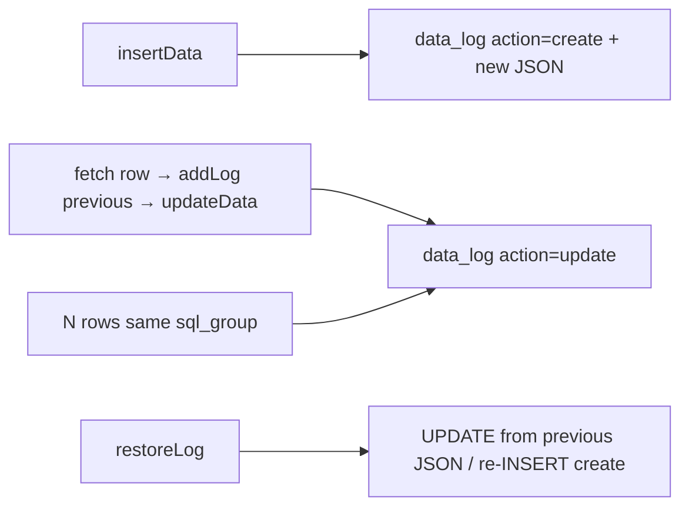

# Data log history and restore

Teach an AI how to keep a **create/update history** in `data_log`, store **previous row JSON** on update (for restore), and **group multi-row** changes under one `sql_group`. Deletes belong in the separate recycle Gate → [12](12-recycle-bin-delete-and-restore.md). Builds on [10 — Database](10-database-communication-in-gate.md).

## When to use

- Audit trail of inserts/updates
- Undo an update by restoring the previous snapshot
- Batch updates that must restore together

## Mental model



## Develop

### 1. Table `data_log` (`db/db_audit.php`)

| Column | Meaning |
|--------|---------|
| `txtaction` | `create` or `update` |
| `txttblname` | Source table |
| `numrecord_id` | Business row id |
| `sqldata` | JSON snapshot (**update = previous row**) |
| `sql_group` | `0` = single; `time()` shared = multi-row batch |
| `restore_status` | `0` open / `1` already restored |
| + | `userid`, `parentid`, `spcmpId`, timestamps |

### 2. Log on create / update

```php
// after insertData:
$row = DbHistoryHelper::fetchRow($db, 'ex11_item', $id);
DbHistoryHelper::addLog($db, $row, 'ex11_item', 'create', $id, 0);

// before updateData:
$before = DbHistoryHelper::fetchRow($db, 'ex11_item', $id);
$group = time(); // share across multi-row
DbHistoryHelper::addLog($db, $before, 'ex11_item', 'update', $id, $group);
$this->page->updateData($form2, $extra);
```

Helper: `apps/examples/DbHistoryHelper.php` (inspired by itkruze `ParentApp` recycle JSON storage).

### 3. Restore

`DbHistoryHelper::restoreLog($db, $logId)`:

- `sql_group > 0` → restore **all** open rows in that group, mark all restored.
- `update` → `UPDATE` table from snapshot (minus PK).
- `create` → re-`INSERT` if missing.

### 4. Demo Gate

`ex11dblog` — items list/edit + `logs` list + `restorelog` + `multitouch` (two-row grouped update).

## Run / test

```bat
sphpdesk\sphpserver\sphpserver-win.exe --proj .\ --port 8000 --host 127.0.0.1
```

Verified 2026-10-25:

1. `/ex11dblog-install.html` → schema status  
2. Add items → `Created id=… (logged)`  
3. Multi-update → `sql_group=…`; logs list shows create/update  
4. Restore log id → `Restored from data_log id=…` (group peers restored)  

## Pitfalls

- Logging **after** update without fetching **before** — nothing to restore.
- Mixing delete into `data_log` — use [12 recycle](12-recycle-bin-delete-and-restore.md).
- Forgetting `sql_group` on multi-row ops — restores become independent.

## Key paths

| Role | Path |
|------|------|
| Gate / Fronts | `apps/examples/Ex11dblog.gate.php`, `ex11dblog_*.front` |
| Helper | `apps/examples/DbHistoryHelper.php` |
| Schema | `db/db_audit.php` |
| Study | `D:\www\sp.itkruze.com\apps\classes\ParentApp.php` (JSON snapshot idea) |

## See also

- [10 — Database](10-database-communication-in-gate.md)  
- [12 — Recycle bin](12-recycle-bin-delete-and-restore.md)  
