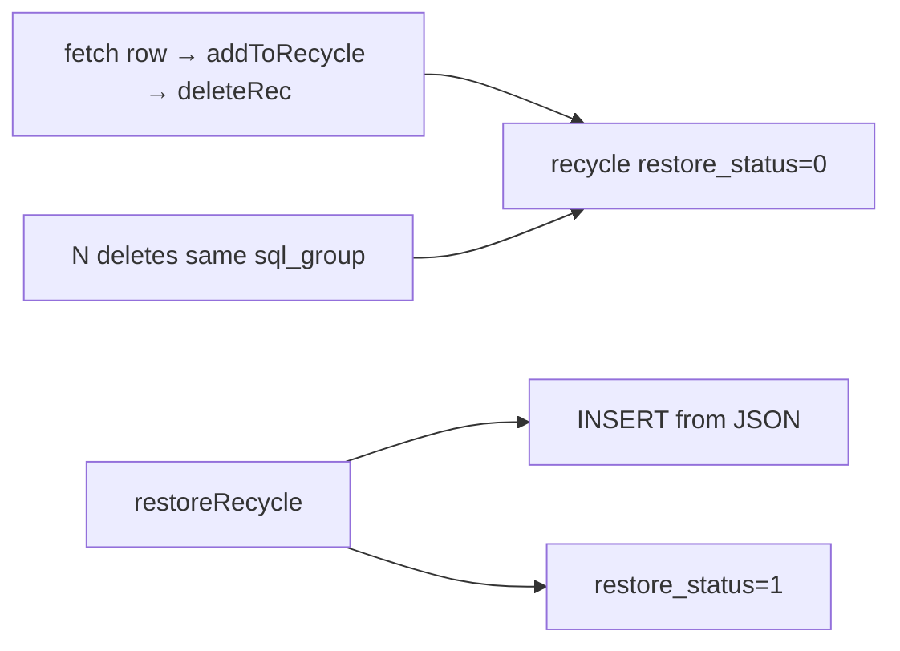

# Recycle bin — delete and restore

Teach an AI how **deleted** rows go to table **`recycle`** (JSON snapshot + table name), then hard-delete, and how a **separate Recycle Gate** lists and restores them (including **multi-row** `sql_group`). Create/update history stays in [11 — data_log](11-data-log-history-and-restore.md). Builds on [10 — Database](10-database-communication-in-gate.md).

## When to use

- Soft-delete UX without keeping deleted rows in the live table
- Restore one or many deleted records
- Align with itkruze `ParentApp::addToRecycle` / `restoreRecycle`

## Mental model



## Develop

### 1. Table `recycle` (`db/db_audit.php`)

| Column | Meaning |
|--------|---------|
| `sqldata` | Full row JSON before delete |
| `txttblname` | Target table for restore INSERT |
| `sql_group` | `0` single; shared timestamp = batch |
| `restore_status` | `0` in bin / `1` restored |
| + | `userid`, `parentid`, `spcmpId`, timestamps |

### 2. Delete → recycle

```php
$row = DbHistoryHelper::fetchRow($db, 'ex11_item', $id);
DbHistoryHelper::addToRecycle($db, $row, 'ex11_item', $group); // $group=0 or time()
$this->page->deleteRec($id);
```

### 3. Restore (separate Gate UI)

```php
DbHistoryHelper::restoreRecycle($db, $recycleId);
// sql_group>0 → insert all peers, mark whole group restored
```

### 4. Demo Gate

`ex12recycle` — list live `ex11_item` rows, delete / multi-delete, **bin** FrontFile to restore.  
Create items via `ex11dblog` (this Gate does not own the edit form).

## Run / test

```bat
sphpdesk\sphpserver\sphpserver-win.exe --proj .\ --port 8000 --host 127.0.0.1
```

Verified 2026-10-25:

1. Items from Ex11  
2. Delete → `Moved id=… to recycle`  
3. Bin → Restore → `Restored recycle id=…`; live list shows titles again  

## Pitfalls

- Restoring without marking `restore_status` — duplicates on second click.
- Using recycle for update undo — that is `data_log` ([11](11-data-log-history-and-restore.md)).
- PK column not `id` — ensure JSON still contains the real PK and INSERT allows it (Sqlite).

## Key paths

| Role | Path |
|------|------|
| Gate / Fronts | `apps/examples/Ex12recycle.gate.php`, `ex12recycle_list.front`, `ex12recycle_bin.front` |
| Helper | `apps/examples/DbHistoryHelper.php` |
| Schema | `db/db_audit.php` |
| Production pattern | `D:\www\sp.itkruze.com\apps\classes\ParentApp.php` |

## See also

- [10 — Database](10-database-communication-in-gate.md)  
- [11 — Data log](11-data-log-history-and-restore.md)  
