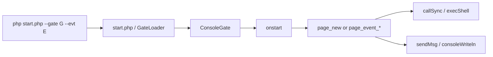

# ConsoleGate — CLI shell commands

Teach an AI how to build and run a **ConsoleGate**: register it, invoke via system PHP + `start.php`, read `--` arguments, and run shell commands with `callSync`. Pair with [14 — NativeGate](14-nativegate-websocket-and-python-child.md) for the same commands over a browser WebSocket UI.

## When to use

- Cron / install / migrate / compile scripts
- One-shot CLI tools that need SartajPhp (`reg.php`, `dbEngine`, auth helpers)
- No browser and no SphpServer

## Mental model



API stub: `vendor/sartajphp/sartajphp/res/Score/SphpDoc/Sphp/Gates/ConsoleGate.php`.

## Develop

### 1. Gate class

```php
// apps/examples/Ex13console.gate.php
class Ex13console extends \Sphp\Tools\ConsoleGate
{
    public function onstart()
    {
        $this->enableStdout();
    }

    public function page_new()
    {
        $this->sendMsg('help…');
    }

    public function page_event_run($evtp)
    {
        $cmd = trim((string) $evtp);
        if ($cmd === '') {
            $cmd = trim((string) $this->consoleReadArgument('--cmd'));
        }
        $out = '';
        $ok = $this->callSync($cmd, $out, 'shell');
        $this->consoleWriteln(trim((string) $out));
        $this->sendMsg($ok ? '[exit ok]' : '[exit fail]', $ok ? 'i' : 'e');
    }
}
```

### 2. Register

```php
// reg.php
registerGate("ex13console", __DIR__ . "/apps/examples/Ex13console.gate.php");
```

### 3. Useful ConsoleGate APIs

| API | Role |
|-----|------|
| `enableStdout` / `disableStdout` | Debug stream |
| `consoleReadArgument('--key')` | Custom CLI flags |
| `callSync($cmd, &$out, $msg)` | Run shell, wait, fill `$out` |
| `calla` / `callf` | Async / streaming callbacks |
| `execShell` / `execute` | Alternate runners |
| `sendMsg($msg, 'i'\|'e')` | Info / error to console |
| `createQue` + `processCmdQue` | Queued commands |

`--evt name` maps to `page_event_name` (same URL/PageEvent rules as web Gates).

## Run

From project root (system PHP with ionCube, same as SphpServer):

```bat
php -f start.php -- --gate ex13console --evt help
php -f start.php -- --gate ex13console --evt demos
php -f start.php -- --gate ex13console --evt run --evtp "php -v"
php -f start.php -- --gate ex13console --evt run --cmd "echo hello"
```

The `--` after `start.php` stops PHP from eating `--gate`.

## Test

Verified 2026-10-25 with system PHP 8.1.3:

| Event | Expect |
|-------|--------|
| `help` / `new` | Usage lines printed |
| `demos` | `php -v`, `echo SartajPhp-shell-ok`, `python -c "print(2+2)"` → `[exit ok]` and `4` |
| `run --evtp "php -v"` | Version banner + `[exit ok]` |

Example Gate: `apps/examples/Ex13console.gate.php`.
