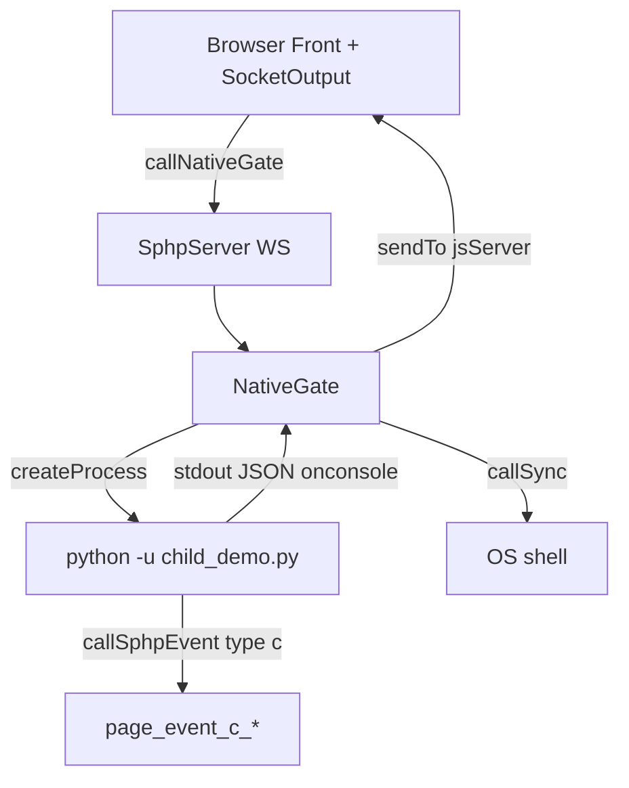

# NativeGate — WebSocket UI and Python child process

Teach an AI how to build a **NativeGate**: SphpServer WebSocket, browser `SocketOutput` / `callNativeGate`, and a **Python child** via `createProcess` + `childCom` (same pattern as movie_gen ComfyUI). Same shell demos as [13 — ConsoleGate](13-consolegate-cli-shell.md), driven from the browser.

## When to use

- Long-running desktop / studio apps (progress, logs, cancel)
- Spawning Python / other binaries that talk back over stdin/stdout
- Multi-client WS broadcast (`sendTo` / `sendAll` / `sendOthers`)

## Mental model



- `NativeGate` **extends** `ConsoleGate` — shell helpers still work inside Gate events.
- Full WS + child lifecycle needs **SphpServer**, not plain `php -S`.
- API stub: `vendor/sartajphp/sartajphp/res/Score/SphpDoc/Sphp/Gates/NativeGate.php`.
- Reference app: `D:\deskapp\sphp\movie_gen\appsn\comfyui\ComfyUI.gate.php` + `appy/sphp/*`.

## Develop

### 1. Split UI Gate vs NativeGate (movie_gen style)

| Role | Class | File |
|------|-------|------|
| HTTP page | `BasicGate` | `apps/examples/Ex14nativeui.gate.php` |
| WS + child | `NativeGate` | `appsn/examples/Ex14native.gate.php` |
| Child | Python 3 | `appsn/examples/python/child_demo.py` |

Front (`ex14nativeui_main.front`):

```html
<div id="div1" runat="server" path="slibPath/comp/server/SocketOutput.php"></div>
<script>
function startGate(){ callNativeGate("ex14native", "startme", "", {}); }
function runPyDemos(){ callNativeGate("ex14native", "pydemos", "", {}); }
</script>
```

### 2. Default vs GlobalGate

| Mode | How | Process model | Lifetime | Good for | Testing |
|------|-----|---------------|----------|----------|---------|
| **Default NativeGate** | omit `setGlobalGate()` | One Gate process (and its child) per WS session / connection family | Ends when that session’s Gate exits (`ExitMe` / quit / disconnect policy) | Per-user studios, demos, most apps | Edit code → Quit / reconnect or new Start; **browser reload often enough** |
| **GlobalGate** | `$this->setGlobalGate()` in `onstart` | **One** process for **all** browser tabs, **all** sessions, **all** users; one shared child | Tied to **SphpServer** — starts on first use, exits only when the **server shuts down** | Chat room, live classroom, WebRTC room, shared live state | Hard: PHP/child changes need **restart SphpServer**; restarting the browser alone does **not** reload the Gate |

`setGlobalGateManager()` can reassign which WS connection is the “manager” of a GlobalGate after the original main connection drops (reload/close).

Ex14 demo uses the **default** (no `setGlobalGate`) so you can iterate without restarting SphpServer. Uncomment `setGlobalGate()` only when you intentionally want a server-lifetime shared room.

### 3. NativeGate skeleton

```php
class Ex14native extends \Sphp\Gates\NativeGate
{
    public function onstart()
    {
        // Optional GlobalGate — see §2 (chat / classroom / WebRTC). Skip while testing.
        // $this->setGlobalGate();
        $this->createProcess($python, array('-u', $childScript), 'demo1');
        $this->sendTo();
    }

    public function page_event_pydemos($evtp)
    {
        foreach ($cmds as $cmd) {
            $this->childCom->callProcess('shell', array('cmd' => $cmd));
        }
    }

    public function page_event_quitme($evtp)
    {
        $this->childCom->sendCommand('quit');
        $this->sendTo();
    }

    public function onconsole($data, $type) { /* push logs via jsServer + sendTo */ }

    public function page_event_c_onready($evtp, $data) { /* child called callSphpEvent */ }

    public function oncquit()
    {
        $this->ExitMe();
    }
}
```

Register both Gates in `reg.php`. Prefer `appsn/` for NativeGate trees.

### 4. Child IPC (minimal)

Parent → child stdin: one **hex** line per message (`fun` / `cmd`), same framing as movie_gen `sphpcom.py`.

Child → parent stdout: JSON lines:

```json
{"id":1,"msg":"…","type":"l","cpdata":""}
```

- `type` `l`/`i`/`w`/`e` → `onconsole`
- `type` `c` + hex `cpdata` → Gate `page_event_c_{evt}`

**Pitfall:** nested `subprocess.run(..., shell=True)` must set `stdin=subprocess.DEVNULL`. Otherwise the child inherits the NativeGate pipe and a nested `python -c` hangs.

### 5. Key NativeGate APIs

| API | Role |
|-----|------|
| `createProcess($exe, $args, $childid)` | Spawn child |
| `$this->childCom->callProcess($fun, $data)` | Invoke child function |
| `$this->childCom->sendCommand('quit'\|'stop')` | Child cmd channel |
| `setGlobalGate` | Run as GlobalGate: one process for all tabs/sessions/users; lives with SphpServer (see §2) |
| `setGlobalGateManager` | Reassign main/manager WS connection on a GlobalGate |
| `sendTo` / `sendAll` / `sendOthers` | WS push |
| `onconsole` / `onwscon` / `onwsdiscon` | Streams / connections |
| `onquit` / `oncquit` | Gate / child exit |
| `page_event_s_onprocesscreate` | Child process ready |

## Run

```bat
sphpdesk\sphpserver\sphpserver-win.exe --proj .\ --port 8000 --host 127.0.0.1
```

Open http://127.0.0.1:8000/ex14nativeui.html → **Start** → **Python demos** / **Ping Python**.

CLI counterpart (same cmds): topic 13 `ex13console --evt demos`.

## Test

Verified 2026-10-25:

1. Start → `createProcess: C:\Python313\python.exe -u child_demo.py`, `s_onprocesscreate`, `log: child_demo ready`, status **Python child ready**
2. Python demos (child): `php -v`, `echo SartajPhp-shell-ok`, `python -c "print(2+2)"` → exit 0 and `4`
3. Ping → `pong from python child: from-browser` + `child onping`
4. ConsoleGate twin: `php -f start.php -- --gate ex13console --evt demos` (topic 13)
