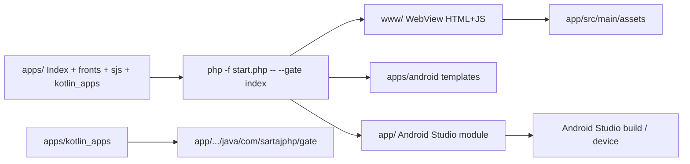

# Mobile App Development

Teach an AI how SartajPhp **hybrid Android** apps differ from the main Web App: a **separate project folder**, an **`index` Gate extending `MobileGate`**, and a generate step that writes **WebView HTML** plus an **Android Studio** module. Reference app: `D:\www\mobilapp\Caller`. Runnable demo: [`mobileapp/`](../../mobileapp/) in this repo.

## When to use

- Shipping a WebView + Kotlin hybrid APK (dialer, tools, offline UI)
- Generating browser assets and Android project from one Gate
- Bridging JS ↔ Kotlin (`callKotlinGate` / `callKotlinGateEvent`)

## Mental model



| Edit (source of truth) | Generated (do not hand-edit as primary) |
|------------------------|-----------------------------------------|
| `apps/Index.gate.php`, fronts, sjs, kotlin_apps, android templates | `www/`, synced `app/src/main/` copies, Manifest / `app/build.gradle.kts` from templates |

`MobileGate` (`Sphp\Tools\MobileGate`) is the framework class. Some apps (e.g. Caller) keep a local copy named `AndroidMobileGate` — same responsibilities.

## Develop

### 1. Separate project under `mobileapp/`

Unlike topics 01–14 (web demo at repo root), mobile work lives in **`mobileapp/`** with its own `start.php`, `reg.php`, `comp.php`:

```text
mobileapp/
  start.php          # $sharedpath → ../vendor/...; set $libVersion to an existing Score folder (e.g. SphpLatest / Sphp8e)
  reg.php            # registerGate("index", apps/Index.gate.php)
  apps/Index.gate.php
  apps/fronts/index_main.front   # home
  apps/fronts/page2.front        # addPage
  apps/sjs/*.sjs                 # Psjs: client JS (comp_/ofjs_/jq_); not onjs_/jevt_ on device
  apps/kotlin_apps/*.kt          # native Gates (bridge)
  apps/android/                  # templates (seeded from jslib/mobileapp/android)
  www/                           # generated
  app/                           # generated Android Studio module
```

Package id defaults to `com.sartajphp.{foldername}` → `com.sartajphp.mobileapp`.

### 2. Index Gate (`page_new`)

```php
class Index extends \Sphp\Tools\MobileGate
{
    public function page_new()
    {
        $this->mobappname = "SphpDoc Mobile Demo";
        $this->minSdkVersion = "26";
        $this->targetSdkVersion = "34";
        $this->compileSdkVersion = "34";

        $this->addAndroidSetting("permission",
            '<uses-permission android:name="android.permission.INTERNET"/>');
        $this->addAndroidSetting("dependency",
            'implementation("androidx.appcompat:appcompat:1.7.0")');

        SphpJsM::addBootStrap();
        $this->addDistLib($this->resourcePath . "/jslib/twitter/bootstrap5");
        $this->addDistLib($this->resourcePath . "/jslib/onsen"); // assets under www/sphpmob
        $this->addPage(new Sphp\Tools\FrontParser($this->myPath . "/fronts/page2.front"));
        $this->setSpecialMetaTag($cspMeta);
    }
}
```

Home UI is always `apps/fronts/index_main.front` (`MobileGate` constructs `FrontFile('main')`). Extra screens use `addPage`.

### 2b. Onsen SPA navigation (reach `page2`)

`www/index.html` is a **single-page** WebView file. Screens from `addPage` are not separate routes — use framework Onsen components (`vendor/.../res/components/uikitdef/onsen/`, especially `OnsenPage.php`):

```xml
<!-- index_main.front — first OnsenPage becomes start page -->
<ons-page id="home" runat="server" path="comppath/uikitdef/onsen/OnsenPage.php">
  …
  <ons-button onclick="onsen.loadPage('page2.html')">Go to Page 2</ons-button>
</ons-page>
```

```xml
<!-- page2.front -->
<ons-page id="page2" runat="server" path="comppath/uikitdef/onsen/OnsenPage.php">
  <ons-back-button>Back</ons-back-button>
  …
</ons-page>
```

Generate emits `<ons-navigator id="onsennavi" page="home.html">` plus `<template id="home.html">` / `<template id="page2.html">`. JS: `onsen.loadPage('page2.html')` → `bringPageTop`.

**Auto-link:** putting `OnsenPage` in a front calls `addFileLink` for Onsen CSS/JS; `MobileGate` folds JS into `sjmm.js`. You do not add a manual `<script src="onsenui.min.js">`. Keep `addDistLib(.../jslib/onsen)` so CSS/fonts copy into `www/sphpmob/resm`. Match page `id` with `apps/sjs` hooks `comp_{id}_init|show|hide|destroy`.

Any SPA library works; this demo uses the built-in Onsen stack for a minimum navigable example.

### 2c. SJS files — clean server-side JS (`Psjs`)

Place `apps/sjs/{same-as-front}.sjs` next to fronts (e.g. `index_main.sjs`, `page2.sjs`). Prefer this over scattering `addHeaderJS*` / `addHeaderJSFunctionCode` in Gate/PHP: write normal JS functions; the framework parses and wires them.

Processor: **`Sphp\Tools\Psjs`** (runtime: `res/Score/{SphpLatest|Sphp8e}/Sphp/Gates/Psjs.php`; not always present under thin `SphpDoc` stubs). It:

1. **`parseJavascript`** — extract each `function name(paras){ body }` from the `.sjs` file  
2. **`fixCompEventHandlers`** — for `comp_{componentId}_{event}`, bind handler name onto the Front component  
3. **`genSJSCode`** — emit client JS (bodies + auto DOM binds) into the page bundle  
4. **`processSJSEvent`** — on an AJAX Gate hit, run matching `onjs_*` / `jevt_*` and return JS via `jsServer` JSON  

**Naming conventions (function name prefixes):**

| Pattern | When | What happens |
|---------|------|----------------|
| `comp_{id}_{event}` | client | Body injected; component event (e.g. Onsen `init`/`show`) calls it |
| `ofjs_{id}_{domEvent}` | client | Auto `$('#id').on(...)` (also drag/drop/resize/key helpers) + body |
| `jq_ready` / `jq_pageload` / `jq_*` | client | Injected into ready / pageload / shared jQuery hooks |
| `onjs_{id}_{event}` | **Server AJAX** | DOM fires `sartajgt` → PHP; `processSJSEvent` runs the SJS body and sends JS back |
| `jevt_*` | **Server AJAX** | Server-only processing, no HTML event attribute |

**Mobile apps:** generate bakes **client** SJS (`comp_*`, `ofjs_*`, `jq_*`) into `www/` / `sjmm.js`. There is **no PHP server** inside the APK, so **`onjs_*` / `jevt_*` / `processSJSEvent` are not usable at runtime** — use Kotlin Gates / `callKotlinGateEvent` instead. Demo:

```javascript
// apps/sjs/index_main.sjs — matches OnsenPage id="home"
function comp_home_init(eventer){ }
function comp_home_show(eventer){ }
function comp_home_hide(eventer){ }
function comp_home_destroy(eventer){ }
```

### 3. Important `MobileGate` APIs

| API | Purpose |
|-----|---------|
| `addPage` / `addDistLib` | Extra fronts + copy JS/CSS trees into `www/sphpmob` |
| `addAndroidSetting($section, $line)` | Sections: `permission`, `application`, `dependency`, `plugins`, `android`, … |
| `addAndroidLibFile` / `addAndroidLibDir` | AAR/libs into `app/libs` |
| `addKotlinGate` / `addKotlinDir` / `addCppDir` / `addJavaDir` | Native sources → `app/src/main/java|cpp|…` |
| `setSpecialMetaTag` | WebView CSP / meta |
| `enableAndroidStudio` (default on) | Publish into project `app/` (Gradle at project root) |
| `disableAndroidStudio` | Alternate `build/` + auto `gradlew assembleDebug` on CLI |
| `setForceCopyGen` | Force-refresh templates from `jslib/mobileapp/android` |
| `enableSphpMobile` | Optional on-device PHP assets |

### 3b. C++ with Kotlin (JNI) — verified demo

`MobileGate::addCppDir($folder)` copies `$folder` into `app/src/main/cpp/{basename}`. Wire CMake in the Android template / `addAndroidSetting("android", …)`:

```php
$this->addCppDir(__DIR__ . "/cpp/nativedemo");
$this->addAndroidSetting("android", '
    ndkVersion = "26.1.10909125"
    externalNativeBuild {
        cmake {
            path = file("src/main/cpp/nativedemo/CMakeLists.txt")
            version = "3.22.1"
        }
    }');
```

| Source | Role |
|--------|------|
| `apps/cpp/nativedemo/nativedemo.cpp` | JNI `Java_com_sartajphp_gate_NativeLib_*` |
| `apps/cpp/nativedemo/CMakeLists.txt` | `add_library(nativedemo SHARED …)` |
| `apps/kotlin_apps/NativeLib.kt` | `System.loadLibrary("nativedemo")` + `external fun` |
| `apps/kotlin_apps/IndexGate.kt` | `page_event_nativeAdd` / `nativeGreet` call C++ |

JS (device WebView):

```javascript
callKotlinGateEvent("index", "nativeAdd", "", { a: 7, b: 5 });
callKotlinGateEvent("index", "nativeGreet", "Ada", { name: "Ada" });
```

Also use `addJavaDir` / `addAndroidLibFile` for Java sources or `.jar`/`.aar` under `app/libs`.

On generate, `sendRenderData` writes `www/index.html` (and root `index.html`), then `publishAndroidApp` syncs assets, Manifest (`config.xml` template), `app/build.gradle.kts`, Kotlin gates, and `regapp.json`.

API stub: `vendor/sartajphp/sartajphp/res/Score/SphpDoc/Sphp/Gates/MobileGate.php`.

### 4. JS ↔ Kotlin (production pattern from Caller)

After WebView loads:

```javascript
callKotlinGate('index');
callKotlinGateEvent('index', 'placeCall', number);
```

Kotlin Gate handles events and pushes UI via jsServer-style bridge (`flush`). Register Kotlin classes in `apps/kotlin_apps/` (e.g. `IndexGate.kt`) → `app/src/main/assets/regapp.json`.

### 4b. Talk to a website (AJAX / NativeGate WebSocket)

The APK has no local PHP Gate, but the WebView can still call a **remote SartajPhp site** the same way a normal web app does:

| client API | Transport | Server side |
|------------|-----------|-------------|
| `getURL` / `getAJAX` (skill [07](07-sartajphp-ajax-library-use.md)) | HTTP AJAX | Remote `BasicGate` + `$this->jsServer` |
| `callNativeGate` / `fun-submitWS` (skill [14](14-nativegate-websocket-and-python-child.md)) | WebSocket | Remote `NativeGate` on SphpServer |

**CSP:** allow those hosts in the Index Gate meta via `setSpecialMetaTag`. Put domains in `$hostlist` so they appear in `default-src`, `connect-src`, `script-src`, etc. Without `connect-src` (and related) entries, the WebView blocks AJAX/WS.

```php
// Prefer real hosts in production; demo uses wildcards for local experiment
$hostlist = "https://api.example.com https://www.example.com wss://api.example.com ";
$meta = '<meta http-equiv="Content-Security-Policy" content="default-src \'self\' 
    data: gap:  ' . $hostlist . ' https://ssl.gstatic.com ; 
    script-src \'self\'  ' . $hostlist . ' \'unsafe-inline\' \'unsafe-eval\';
    style-src \'self\'  ' . $hostlist . ' \'unsafe-inline\';
    media-src *; img-src * data: content:; frame-src  ' . $hostlist . ' ; 
    connect-src \'self\' ' . $hostlist . ' ;">
    …';
$this->setSpecialMetaTag($meta);
```

Also keep Android `INTERNET` permission (`addAndroidSetting("permission", …)`). AJAX/`jsServer` behavior matches other web apps once CSP + network allow the URL.

### 5. Compare to web Gates

| | Web (`BasicGate`) | Mobile (`MobileGate`) |
|--|-------------------|------------------------|
| Project | Repo root / `apps/examples` | Dedicated folder e.g. `mobileapp/` |
| Output | HTTP HTML via Master | `www/` + Android `app/` |
| Run | SphpServer browser | Generate → Android Studio / device |
| Native | Optional NativeGate WS | Kotlin Gates + WebView bridge |

## Run

```bat
cd mobileapp
php -f start.php -- --gate index
```

Then open **`mobileapp/`** in Android Studio → Sync → Run. Preview WebView HTML also at `mobileapp/www/index.html` (static).

Caller CLI pattern: `python caller_cli.py generate` ≡ same `php -f start.php -- --gate index`.

## Test

Verified 2026-10-26 in `mobileapp/`:

1. `php -f start.php -- --gate index` completes; fronts `index_main` + `page2` run  
2. `www/index.html` has `ons-navigator` / `template id="home.html"` / `template id="page2.html"` and `onsen.loadPage(...)`  
3. `sjmm.js` includes Onsen UI + `window.onsen.loadPage` (component auto-link; not a separate script tag)  
4. `app/src/main/assets/index.html` synced; `regapp.json` → `"index": "com.sartajphp.gate.IndexGate"`  
5. `apps/android/MainActivity.kt`, `app/build.gradle.kts`, `AndroidManifest.xml`, `IndexGate.kt` under `app/src/main/java/com/sartajphp/gate/` present  
6. C++ path: `app/src/main/cpp/nativedemo/` + gradle `externalNativeBuild`; home buttons **C++ addInts** / **greet**  

Full NDK/APK compile needs Android Studio + NDK on the machine (open `mobileapp/`, Sync, Run). Preview SPA nav in a browser by opening `mobileapp/www/index.html` (Onsen in `sjmm.js`).
