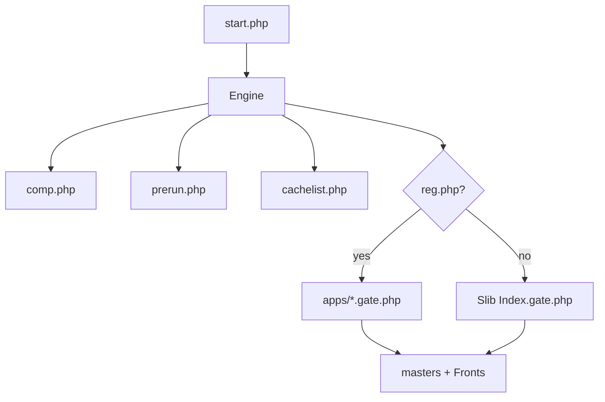

# Minimum project files

Teach an AI the **smallest file set** needed to run a SartajPhp web app, and what is optional.

## When to use

- Creating a new project from an empty folder  
- Deciding whether `reg.php` / `apps/` are required  
- Understanding default Index from Slib when no project Gate exists  

## Mental model



## Develop — required vs optional

| File / folder | Role | Required? |
|---------------|------|-----------|
| `start.php` | Boot; `$sharedpath`, `$resourceUrl`, `$libVersion` (e.g. `SphpLatest`) → `res/Score/{lib}/global/start.php` | Yes |
| `comp.php` | `$debugMode`, `$dbEnginePath`, `$masterf`, mail/auth globals | Yes |
| `prerun.php` | `SphpPreRun::onstart` before Gates | Yes (typical) |
| `cachelist.php` | `addCacheList` registry (can be empty `<?php`) | Present / empty OK |
| `masters/` | Master layout | Yes for HTML pages |
| `cache/`, `plugin/` | Engine / sessions / plugins | As needed |
| `reg.php` + `apps/` | Register custom Gates | **Optional** |
| `vendor/` | Framework (Composer) | Yes |

Without project Gates, the framework serves shared **`vendor/.../res/Slib/apps/Index.gate.php`** (contacts / quote flow). Adding `reg.php` overrides/extends that with your Gates.

This documentation repo is already a working minimum **plus** example Gates under `apps/examples/`. To teach “empty app,” ignore those examples and keep root boot files + one Master.

### Cloud apps

For developers, a **Cloud** app is the same pattern as a **NativeGate + SphpServer** app ([14](14-nativegate-websocket-and-python-child.md)) — no separate framework mode. Hosting/orchestration belongs outside this skill set.

## Run

```bat
sphpdesk\sphpserver\sphpserver-win.exe --proj .\ --port 8000 --host 127.0.0.1
```

Or system PHP: `php -f start.php -- --gate index`

## Test

Confirm `start.php` + `comp.php` + Master render default or registered Index; add one Gate in `reg.php` and hit `yourgate.html`.

## Related

- Structure / APIs: [02](02-project-structure-and-important-apis.md)  
- Pipeline: [01](01-browser-request-and-sartajphp-response-workflow.md)  
- Install overview: [ebook](https://www.sartajphp.com/ebook-fullbook.html)  
