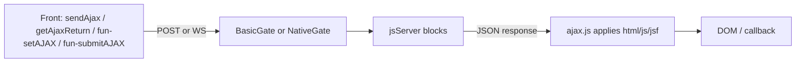

# SartajPhp AJAX Library Use

Teach an AI how browser **AJAX JS helpers** (`ajax.js`) talk to a Gate, and how the Gate answers with **`$this->jsServer`** JSON blocks (HTML, JS, return data, FrontFile fragments). Builds on [01 — request/response](01-browser-request-and-sartajphp-response-workflow.md) and [03 — Gates / PageEvents](03-how-to-write-gate-class-and-handle-events.md). WebSocket / NativeGate → [14](14-nativegate-websocket-and-python-child.md).

## When to use

- Partial page updates without full reload
- AJAX forms (`fun-setAJAX`) and button-driven `page_event_*`
- Component-bound live submit (`fun-submitAJAX` / `fun-submitWS`) without hand-written `sendAjax`
- Returning data to a JS callback (`getAjaxReturn`)
- Swapping a FrontFile panel into a holder (`addJsonFront`)

## Mental model



**Rule:** If the browser uses framework AJAX (`sendAjax` / `getAjaxReturn` / `fun-setAJAX` / `fun-submitAJAX`), the Gate **must** respond with `$this->jsServer` (same as `SphpBase::jsServer()`). Custom `fetch`/`XHR` will **not** auto-apply those blocks — you would parse JSON yourself.

Do **not** call `setFrontFile` for a pure AJAX JSON response unless you intentionally return a full page.

## Develop

### 1. Browser helpers (`ajax.js`)

Loaded with the app (master / framework). Prefer these over raw `fetch`:

| API | Signature (typical) | Role |
|-----|---------------------|------|
| `sendAjax` | `sendAjax(url, data, runbackground?)` | Fire-and-forget AJAX; jsServer blocks applied automatically |
| `getAjaxReturn` | `getAjaxReturn(url, data, runbackground, callback)` | Same + `callback(ret)` for `addJsonReturnBlock` |
| Form AJAX | `fun-setAJAX=""` on `<form runat="server">` | Submit posts as AJAX to `action` URL |
| Component AJAX | `fun-submitAJAX` → `fu_submitAjax` | Bind DOM event; auto-generate JS that posts this + extra Components |
| Component WS | `fun-submitWS` → `fu_submitWs` | Same values via WebSocket → NativeGate (`callProcessNativeGate`) |
| WS helper | `callNativeGate(gate, evt, evtp, data)` | NativeGate — skill 14 |

Build URLs with expression tags:

```html
##{getEventUrl('ping')}#          → ex07ajax-ping.html
##{getEventUrl('panel','info')}#  → ex07ajax-panel-info.html
```

Source: `vendor/sartajphp/sartajphp/res/Slib/comp/server/assets/ajax.js`.

### 2. Gate + jsServer

```php
public function page_event_ping($evtp)
{
    $this->jsServer->addJsonHtmlBlock('spnStatus', 'Pong');
    $this->jsServer->addJsonJsBlock("$('#spnStatus').addClass('text-success');");
    $this->jsServer->callJsFunction('onAjaxPing', 'Pong');
}

public function page_event_echo($evtp)
{
    $this->jsServer->addJsonReturnBlock(array('ok' => true, 'echo' => $text));
}
```

| jsServer method | Browser effect |
|-----------------|----------------|
| `addJsonHtmlBlock($tagId, $html)` | Set element HTML by id |
| `addJsonJsBlock($js, $type = 'jsp')` | Execute JS (`jss`/`js`/`jsp`/`jsf` priority order) |
| `callJsFunction($name, …$args)` | Invoke a global JS function |
| `addJsonReturnBlock($data)` | Payload for `getAjaxReturn` callback |
| `addJsonFront($frontFile, $outId)` | Render FrontFile into `#outId` |
| `addJsonComp` / `addJsonCompChildren` | Inject Component markup |
| `addJsonBlock($sact, $evtp, $data)` | Low-level block (`html`, `js`, `jsf`, …) |
| `flush()` | Send accumulated JSON early (long-running / NativeGate) |

API stub: `vendor/sartajphp/sartajphp/res/Score/SphpDoc/Sphp/Kit/JsServer.php`.

`JsServer::getAjaxReturn()` (PHP) **enables** the AJAX client library path — different from browser `getAjaxReturn()`.

### 3. Form AJAX pattern

```html
<form id="frmCalc" runat="server" fun-setAJAX="" action="##{getEventUrl('calc')}#">
  <input id="numa" type="number" runat="server" />
  …
  <button type="submit">Calculate</button>
</form>
```

```php
public function page_event_calc($evtp)
{
    $a = (int) $this->frtMain->numa->value;
    $b = (int) $this->frtMain->numb->value;
    $this->jsServer->addJsonHtmlBlock('spnResult', (string) ($a + $b));
}
```

Same idea as project `apps/IndexBack.gate.php` (`page_event_formsub`) and RAG samples under `vendor/.../res/Score/rag/samples/calculator_ajax_*.md`.

### 4. Component `fu_submitAjax` / `fu_submitWs`

Defined on `Component` (`vendor/.../SphpDoc/Sphp/Tools/Component.php`). Fusion attrs generate **all** client JS: bind a DOM event, collect this Component’s value plus optional extras, then submit.

**FrontFile syntax** (comma + `|` separates args, same fusion style as other `fun-*`):

```html
<!-- AJAX: event,|url,|extraComponentIds -->
<input id="liveA" runat="server"
  fun-submitAJAX="keyup,|##{getEventUrl('calc')}#,|liveB,liveOp" />

<!-- Empty URL → post to renderer Gate event page_event_{id}_{event} -->
<input id="txtLive" runat="server" fun-submitAJAX="keyup" />

<!-- WS twin: event,|host,|extraIds,|nativeGate,|evt,|evtp -->
<input id="txtWs" runat="server"
  fun-submitWS="click,|,|txtOther,|ex14native,|shell,|" />
```

| API | Role |
|-----|------|
| `fu_submitAjax($eventName, $url = "", $extracomp = "")` | Bind `$eventName` (e.g. `keyup`, `change`, `click`). If `$url` empty → default `getEventUrl("{compId}_{event}")` → Gate `page_event_{compId}_{event}`. `$extracomp` = comma-separated tag ids (or `.class`) included in the POST. |
| `fu_submitWs($eventName, $host = "", $extracomp = "", $gate, $evt, $evtp)` | Same payload idea over WebSocket: `getSphpSocket` → `callProcessNativeGate($gate,$evt,$evtp,data)`. Empty `$host` uses the page SocketOutput / default WS. |

Some form Components (e.g. `TextFieldPost`) debounce (`delay` ms) so typing does not flood the server.

Generated handler names look like `comp_txtLive_keyup` (AJAX) or `compws_…` (WS). Gate still answers AJAX with **jsServer**.

See also index demo: `apps/fronts/index_main.front` (`fun-submitAJAX` → `indexback` `page_event_txtname_keyup`).

### 5. Example layout

| File | Role |
|------|------|
| `apps/examples/Ex07ajax.gate.php` | `ping` / `echo` / `calc` / `panel` / `txtLive_keyup` |
| `apps/examples/fronts/ex07ajax_main.front` | `sendAjax` / `getAjaxReturn` / `fun-setAJAX` / `fun-submitAJAX` |
| `apps/examples/fronts/ex07ajax_panel.front` | Fragment for `addJsonFront` |

Register: `registerGate("ex07ajax", …)` in `reg.php`.

## Run

```bat
sphpdesk\sphpserver\sphpserver-win.exe --proj .\ --port 8000 --host 127.0.0.1
```

Open http://127.0.0.1:8000/ex07ajax.html — Ping, Echo, Calculate, panels, and section **5** live `fun-submitAJAX` fields.

## Test

Verified 2026-10-26 (POST + `X-Requested-With`):

| Call | Expect in jsServer JSON |
|------|-------------------------|
| `ex07ajax-ping.html` + `txtname=Ada` | `html.spnStatus` = `Pong Ada @ …`; JS includes `onAjaxPing` / `text-success` |
| `ex07ajax-echo.html` + `txt=hello AJAX` | return payload with `"ok"` and `hello AJAX` |
| `ex07ajax-calc.html` + `7 + 3` | `spnResult` = `10`, status `7 + 3 = 10` |
| `ex07ajax-panel-info.html` | `panelHolder` contains Info panel from `addJsonFront` |
| Page HTML | Generated `comp_liveA_keyup` / `comp_txtLive_keyup` |
| `ex07ajax-calc.html` + `liveA=4&liveB=5&liveOp=+` | `spnResult` = `9` |
| `ex07ajax-txtLive_keyup.html` + `txtLive=hello-live` | `spnLive` = `Live: hello-live` |
