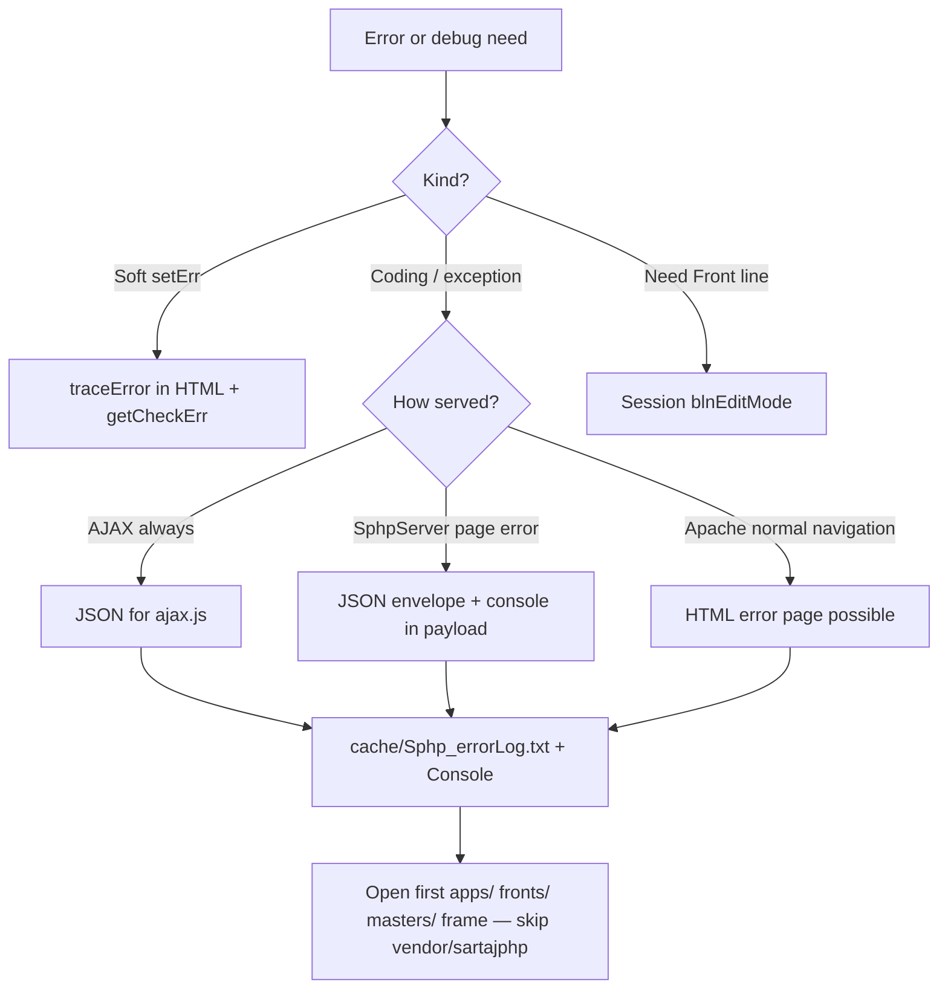

# Debugging and error tracing

Teach an AI how to **enable debug/edit mode**, **read errors**, and **find the app file to fix** — without chasing framework internals. Example Gate: `apps/examples/Ex16debug.gate.php`. Builds on [01](01-browser-request-and-sartajphp-response-workflow.md) (pipeline, soft vs coding errors). Framework docs: [ebook2](https://www.sartajphp.com/ebook2-fullbook.html).

## When to use

- Page blank, wrong Gate/Front, or “Something goes wrong!”
- Live site: show source markers only to your session
- Distinguishing user validation errors from PHP crashes

## Mental model



## Develop

### 1. Debug mode — `comp.php`

```php
$debugMode = 2; // 0=off, 1=errors, 2=warnings, 3=verbose (Front/Component detail)
```

Overrides `vendor/.../Score/global/global.php`. With `$debugMode > 0`, SartajPhp prints Gate file, event, `$evtp`, and Front paths to the **browser console** (normal and AJAX). Custom lines:

```php
$this->debug->println('checkpoint');
SphpBase::debug()->print_r($arr);
```

Critical PHP crashes may skip console output — read **`cache/Sphp_errorLog.txt`**.

### 2. Session edit mode — `prerun.php` (live-safe)

`SphpBase::sphpSettings()->blnEditMode = true` adds Master/Front source hints in HTML:

| Marker | Meaning |
|--------|---------|
| Meta / wrappers | Master and Front identities |
| `data-sedt` | Front file name (Component/tag origin) |
| `data-sedtl` | Line number in that Front |
| `data-sedtt` | Character offset |

Dynamically generated HTML has **no** these attributes.

Enable **only for one session** (project already does this):

```php
class SphpPreRun extends Sphp\Core\SphpPreRunP{
    public function onstart(){
        $passtoken = "abc"; // use a strong secret on live sites
        if (\SphpBase::sphpRequest()->session("edtmode") == $passtoken) {
            \SphpBase::sphpSettings()->blnEditMode = true;
        } else if (\SphpBase::sphpRequest()->request("edtmode") == $passtoken) {
            \SphpBase::sphpRequest()->session("edtmode", $passtoken);
            \SphpBase::sphpSettings()->blnEditMode = true;
        }
    }
}
```

Visit once: `ex16debug.html?edtmode=abc`. Later requests in that browser keep edit mode; **other users never see it**. Do not set `blnEditMode = true` globally on production.

Optional API: `SphpBase::sphpSettings()->enableEditing()` / `disableEditing()`.

### 3. Soft vs coding errors

| Type | API | Stops PHP? | Where you see it |
|------|-----|------------|------------------|
| Soft / logical (forms, business) | `setErr` / `getCheckErr` / `traceError` | No | HTML (Master footer), decisions in Gate |
| Soft (developer extra) | `setErrInner` / `traceErrorInner` | No | Debugmode / Master footer |
| Coding / exception | `throw`, fatals, notices | Often yes | Console, log; format depends on server (below) |

```php
SphpBase::sphpApi()->setErr('id', 'User-facing message');
SphpBase::sphpApi()->setErrInner('id', 'Dev hint: apps/examples/Ex16debug.gate.php …');
if (SphpBase::sphpApi()->getCheckErr()) { /* rollback / skip write */ }
```

Master pattern (this demo):

```php
echo SphpBase::sphpApi()->traceError(true) . SphpBase::sphpApi()->traceErrorInner(true);
```

### 4. Error **response format** (AJAX / SphpServer / Apache)

| Channel | Typical error body |
|---------|-------------------|
| **AJAX** (`sendAjax` / `getAjaxReturn` / submitAJAX) | Always **JSON** (jsServer / ajax.js). Inspect Network → Response and Console. |
| **SphpServer** normal page that hits a coding failure | Often **JSON** envelope (`Something goes wrong!`, `console.error(…)` inside payload) — not a full HTML error document. |
| **Apache** (or PHP-FPM) browser navigation | Can return **HTML** error / exception page. |

So: JSON error ≠ “only AJAX”. Under SphpServer, failed page loads may look like AJAX JSON too. Under Apache, open the HTML view-source. In all cases use **Console** + **`cache/Sphp_errorLog.txt`**.

### 5. How to find the file to fix (ignore framework)

1. Read the message / stack / log line.  
2. **Skip** frames under `vendor/sartajphp/` (and ionCube/`libsphp*.php` noise).  
3. Open the first path under **`apps/`**, **`fronts/`**, or **`masters/`**.  
4. With edit mode, use `data-sedtl` / `data-sedt` to jump to the Front line.  
5. Confirm Gate/Front from console: `Gate:- … Registered-File: … FrontFile Run:- …`.

Ex16 deliberately errors in `apps/examples/ex16_buggy_helper.php` and `Ex16debug.gate.php` so the app frame is obvious.

## Run

```bat
sphpdesk\sphpserver\sphpserver-win.exe --proj .\ --port 8000 --host 127.0.0.1
```

| URL | What to try |
|-----|-------------|
| `/ex16debug.html` | Status panel; console Gate/Front lines |
| `/ex16debug.html?edtmode=abc` | Then reload — inspect `data-sedt*` |
| `/ex16debug-soft.html` | Soft error via Master `traceError` |
| `/ex16debug-code.html` | App notice → log / console |
| `/ex16debug-boom.html` | Exception; under SphpServer expect **JSON** with app file in text |

## Test

Verified 2026-10-26 with SphpServer:

1. `ex16debug.html` → HTML; `comp.php` debugMode **2**; edit OFF  
2. `?edtmode=abc` then same URL → `data-sedt` present (session edit)  
3. `ex16debug-soft.html` → soft user message present  
4. `ex16debug-code.html` / boom → `cache/Sphp_errorLog.txt` mentions `ex16_buggy_helper` / `Ex16debug.gate.php`  
5. Boom under SphpServer → JSON body containing app Gate path (not a full Apache-style HTML error page)

## Related

- Soft vs coding errors overview: [01](01-browser-request-and-sartajphp-response-workflow.md)  
- AJAX JSON success path: [07](07-sartajphp-ajax-library-use.md)  
- Master footer `traceError`: [05](05-master-file-design.md)  
