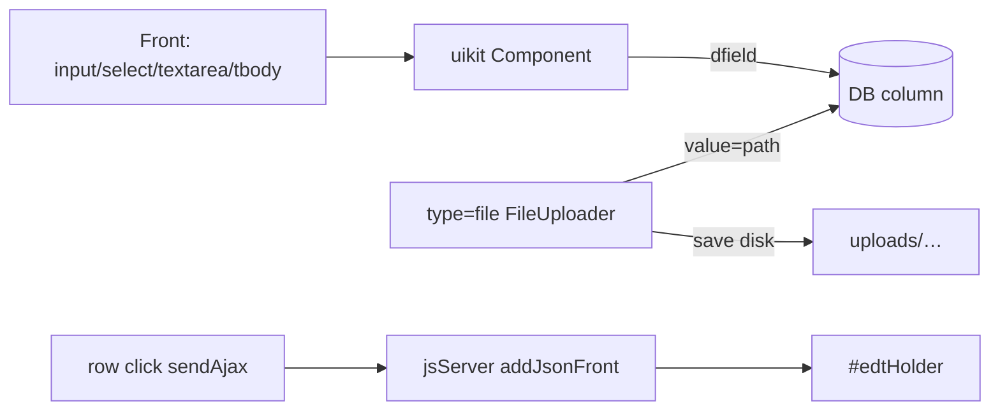

# Built-in form and data Components

Teach an AI to reuse SartajPhp **uikit form/data Components** instead of reinventing uploads, selects, grids, and AJAX edit panels in every Gate. Demo Gate: `ex17comps`. Fusion timing rules also live in [06](06-component-design-and-basic-components.md). Online reference: [ebook2](https://www.sartajphp.com/ebook2-fullbook.html).

## When to use

- File upload (client picker + server save) with safe MIME types
- Select / TextArea bound to DB columns
- Paged lists (Pagination / Grid) with Components inside rows
- Open edit form via AJAX when the user clicks a grid/list row
- Sending mail from a Gate (or any Composer library)

## Mental model



## Develop

### Fusion rules (short — full text in [06](06-component-design-and-basic-components.md))

| Layer | Rule |
|-------|------|
| Component PHP | **`fi_*`** = init-time methods (validation, bind, upload MIME/path). **`fu_*`** = render-time (and Gate) methods |
| Front `fui-*` | Calls **`fi_*` only**, once at init |
| Front `fur-*` | Calls **`fu_*` only**, on **each** render (multi HTML from one object) |
| Front `fun-*` | May call `fi_*` at init and/or `fu_*` at render, but **once** for the Component’s life |
| Gate | Prefer Front fusion. Avoid late `fi_*` after `new FrontFile`. **`fu_*` anytime but one owner; Front usually wins; prefer Front fusion; Gate only to change flow and change value in different Page-Events — if you call `fu_*` in Gate, do not use it on the Front; always set in Gate class** |

Shared strings: Gate public property → Front expression (e.g. `$uploadDir`).

### 1. File upload — `FileUploader`

Two jobs: (1) browser file control, (2) save on server. Prefer Component + Front fusion — not raw `move_uploaded_file` in every Gate.

**`input type="file"` → `Sphp\Comp\Form\FileUploader`** (built-in tag map). Source: `vendor/.../uikitdef/bootstrap/form/FileUploader.php`.

**Gate — one path property + mkdir only:**

```php
public $uploadDir = PROJ_PATH . '/uploads/ex17/'; // trailing slash — concatenated with generateFileName()

public function onstart()
{
    if (!is_dir($this->uploadDir)) {
        @mkdir($this->uploadDir, 0777, true);
    }
    $this->genFormFront = new FrontFile('edit'); // fui-* / fi_* run here (DOM order)
    // …
}
```

**Front — all FileUploader setup via fusion:**

```html
<input id="file1" runat="server" type="file"
       dfield="txtfilepath" dtable="ex17_doc"
       fui-setForm="form2"
       fun-setMsgName="Attachment"
       fun-setDisplayFile=""
       fui-setFileTypesAllowed="image/jpeg,image/png,image/gif,application/pdf"
       fui-setFileMaxLen="2097152"
       fui-setFileSavePath="##{$parentGate->uploadDir . $file1->generateFileName()}#" />
```

`fui-setFileSavePath` runs at **init**, before `oncreate` → `saveFile`. That is why path/MIME belong on the Front (or must be set before/during init), not in `page_submit` via late `fi_setFileSavePath`.

| Rule | Why |
|------|-----|
| `$uploadDir` on Gate + expression on Front | One literal; Front and mkdir stay aligned |
| Trailing `/` on `$uploadDir` | `uploadDir . generateFileName()` must form a valid path |
| No `if ($file1 !== null)` | Missing Component errors; null-check is useless |
| No Gate `fi_set*` for upload after `FrontFile` | `saveFile` already ran |

- Persist **path** with `dfield` / `insertData` / `updateData` — not file bytes.
- MIME allow-list blocks PHP / unexpected types.
- Form: `enctype="multipart/form-data"`.

### 2. Select

```html
<select id="sltcategory" runat="server" dfield="sltcategory" fui-setForm="form2"
        fun-setOptions="general=General,policy=Policy"
        fun-setFirstValue="— pick —"></select>
```

Also: `fun-setOptionsJSON`, `fun-setOptionsFromTable`, `fun-setOptionsArray`. Class: `Sphp\Comp\Form\Select`.

### 3. TextArea (HTML / long text / code-like content)

```html
<textarea id="txabody" runat="server" dfield="txabody" fui-setForm="form2" rows="6"></textarea>
```

Stores the submitted string in the DB column (`TEXT`). Good for HTML fragments or PHP-like text the app stores as data (not executed). Class: `Sphp\Comp\Form\TextArea`.

### 4. Pagination and Grid

| Component | Path keyword example | Role |
|-----------|----------------------|------|
| Pagination | `uikit/data/Pagination.php` | Simple paged `<tbody>` |
| Grid | `uikit/data/Grid/Grid.php` | Richer list / dialogs |

Inside each row, use holders bound to the list Component:

```html
<tbody id="showall" runat="server" path="uikit/data/Pagination.php"
       fun-setFieldNames="id,txttitle" dtable="ex17_doc">
  <tr onclick="sendAjax('##{getEventUrl('rowclick', $showall->getRow('id'))}#');">
    <td runas="holder" sphp-comp="showall" dfield="txttitle"></td>
  </tr>
</tbody>
<div id="pagebar">##{$showall->getPageBar()}#</div>
```

`uikit` resolves to the active Component UI kit (`$uiKitLocation` in `comp.php` / settings).

### 5. AJAX edit on row click

Same pattern as `AutoGate::page_event_rowclick`:

```php
public function page_event_rowclick($evtp)
{
    $this->page->viewData($this->genFormFront->getComponent('form2'), $evtp);
    $this->jsServer->addJsonFront($this->genFormFront, 'edtHolder');
}
```

List page keeps an empty `#edtHolder`; click fills it without full navigation. Page changes: `page_event_showall_show` → `addJsonComp` + `getPageBar()` HTML.

### 6. Mail and Composer libraries

Shared Index quote handler (`vendor/.../Slib/apps/Index.gate.php` → `page_event_subquote`):

- Builds a FrontFile for the contact form Components  
- `include_once(.../classes/bundle/email/SMTPMail.php)`  
- `SMTPMail::sendMail(...)` when `!getCheckErr()`  

You may `require` **any Composer** package inside a Gate the same way (autoload in `prerun` or Gate). Configure `$mailServer` / `$mailUser` / `$mailPass` in `comp.php`.

## Run

```bat
sphpdesk\sphpserver\sphpserver-win.exe --proj .\ --port 8000 --host 127.0.0.1
```

| URL | Action |
|-----|--------|
| `/ex17comps-install.html` | Create `ex17_doc` via `db_index` |
| `/ex17comps.html` | List + AJAX holder |
| `/ex17comps-addnew.html` | Full-page form with file field |

## Test

Verified 2026-10-26 (SphpServer): list / install / addnew return HTML (not error JSON). FileUploader resolves via `type=file` map. Soft failures under SphpServer still appear as JSON envelopes — see skill [16](16-debugging-and-error-tracing.md).

## Related

- DB helpers / Pagination overview: [10](10-database-communication-in-gate.md)  
- AJAX / jsServer: [07](07-sartajphp-ajax-library-use.md)  
- Component design: [06](06-component-design-and-basic-components.md)  
- Framework docs: [ebook2](https://www.sartajphp.com/ebook2-fullbook.html) · [API](https://www.sartajphp.com/api/)  
